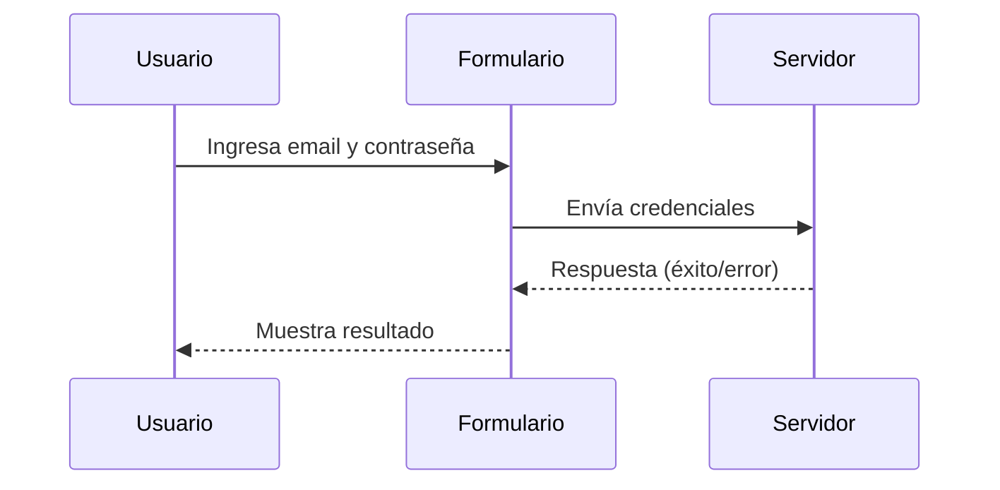
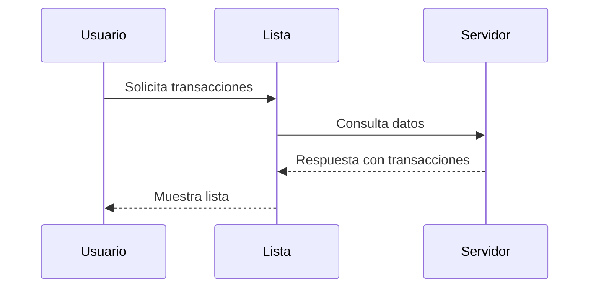

# Prompt para Mejorar el Codigo Base

Copia y pega el contenido del bloque de abajo en un asistente de IA (Claude, ChatGPT)
para obtener un ZIP con el proyecto completo y arrancable.

Si preferis trabajar en tu editor con un agente local (Claude Code, Cursor, Copilot), usa `AGENTS.md` en vez de este archivo: dice lo mismo pero para que escriba los archivos en disco.

## Las dos reglas que no se negocian

1. **Completa el boilerplate.** Todo lo que el proyecto necesita para compilar y arrancar: manifiesto de dependencias, punto de entrada, configuracion, capa de interfaz, y las capas del patron arquitectonico declarado. Eso es andamiaje y es tu trabajo.
2. **NO resuelvas el reto.** Los entregables de las fases son el trabajo de la persona. El hueco pedagogico se deja como esta: el proyecto arranca, pero lo que el reto pide implementar NO esta implementado.

Dicho de otra forma: si algo impide compilar, arreglalo. Si algo es logica de negocio incompleta, validaciones ausentes, un secreto hardcodeado o un patron mejorable, dejalo exactamente como esta — es lo que la persona tiene que encontrar.

## Como saber que terminaste

```bash
python3 -c "import json; json.load(open('design-tokens.json'))"
```

Ese comando corriendo sin errores es la definicion de "listo".

---

```
## Briefing del reto (autoridad)
Este bloque manda sobre los archivos adjuntos. El stack y el rol salen de AQUÍ, no de un topic genérico ni de markdown placeholder.

### Perfil
Chapter Diseño de soluciones, Especialidad Product Designer, Tecnología Diseño UI, Advanced

### Brecha de conocimiento
Ha optimizado el trabajo a través de la creación y uso de librerías de componentes, usa constantemente las funciones avanzadas de las herramientas de diseño UI que domina.

### Misión / candidato
Candidato con nivel Advanced en Diseño de soluciones, experiencia como Product Designer.

### Reto
- Tema: Dominio avanzado de herramientas de diseño UI
- Seniority: advanced-l2
- Tipo: practical
- Título: Optimización y Uso Avanzado de Herramientas de Diseño UI
- Tiempo estimado: 10 horas

### Fases (trabajo del HUMANO — PROHIBIDO completarlas)
No implementes estos entregables. Dejalos como hueco pedagógico. El asistente solo materializa el proyecto arrancable para que el participante pueda trabajar.
- Fase 1: Creación de una librería de componentes — objetivo: Diseñar y documentar una librería de componentes reutilizables para la empresa. — entregable (NO resolver): Librería de componentes documentada.
- Fase 2: Uso de funciones avanzadas de las herramientas de diseño UI — objetivo: Demostrar el uso de funciones avanzadas de las herramientas de diseño UI para mejorar la eficiencia y la calidad del diseño. — entregable (NO resolver): Diseño UI que utiliza funciones avanzadas de la herramienta de diseño.
- Fase 3: Evaluación y mejora continua de la librería de componentes — objetivo: Evaluar y mejorar continuamente la librería de componentes para asegurar su relevancia y efectividad. — entregable (NO resolver): Librería de componentes actualizada y documentada.

Eres un asistente experto en análisis, corrección y generación de archivos de cualquier tipo:
código fuente, documentación, hojas de cálculo, documentos Word, configuraciones, entre otros.
Voy a enviarte una cadena de texto que contiene uno o más archivos. Cada archivo está delimitado por un marcador con el siguiente formato:
// === ARCHIVO: ruta/del/archivo.extension ===
o también puede aparecer como:
## === ARCHIVO: ruta/del/archivo.extension ===
Lo que sigue al marcador puede ser:

El contenido real del archivo (código, texto, YAML, etc.)
Una descripción en lenguaje natural de lo que debe contener el archivo


TU TAREA
PASO 0 — ¿Esto es un proyecto o una carcasa?
Antes de extraer archivos, leé el Briefing (si está) y diagnosticá el adjunto.

Es CARCASA si ocurre CUALQUIERA de estas:
- No hay manifiesto de dependencias del stack del briefing (manifest.json de VTEX IO / package.json / pom.xml / build.gradle / requirements.txt / go.mod / *.tf / *.csproj, según corresponda)
- Hay un "binario" que en realidad es un comentario ("no puede ser mostrado como texto plano", placeholder .fig/.docx vacío)
- Los markdowns ya completan entregables de fases posteriores ("se implementó fade-in", lista de áreas ya resuelta)

Si es CARCASA:
- MATERIALIZÁ un proyecto que arranca en el stack del briefing (VTEX IO Store Framework, Angular, Terraform, pytest, Nest, etc.). Incluí manifiesto, punto de entrada y capa de interfaz reales.
- NO copies los markdowns de "solución" como si fueran el producto. Son ruido de generación.
- NO resuelvas las fases del briefing (están marcadas PROHIBIDO). Dejá el hueco pedagógico: el flujo existe, las microinteracciones/calidad/infra que el reto pide NO están hechas.
- Después seguí al PASO 5 (ZIP).

Si es un proyecto REAL (manifiesto + código que compila o arranca):
- Seguí PASO 1 en adelante. 🔴 compilación sí. 🟡 pedagógico no.

PASO 1 — Detección y extracción
Identifica todos los archivos presentes en la cadena. Para cada archivo extrae:

Su ruta completa (ej: src/main/java/com/pragma/Service.java)
Su contenido o descripción

PASO 2 — Clasificación por tipo
Clasifica cada archivo en una de estas categorías:
A) Código fuente (Java, Python, TypeScript, JavaScript, Kotlin, etc.)
B) Configuración / documentación (YAML, properties, Markdown, JSON, txt, etc.)
C) Excel (.xlsx, .xls, .csv)
D) Word (.docx, .doc)
E) Otro tipo de archivo binario o especial
PASO 3 — Clasificación de errores en código fuente

Objetivo prioritario: que el proyecto compile. No corrijas flujo de negocio ni lógica funcional.

Antes de modificar cualquier archivo de código fuente, clasifica cada problema encontrado en una de estas dos categorías:
🔴 ERROR DE COMPILACIÓN — corregir siempre
Son errores que impiden que el proyecto arranque, sin valor pedagógico:

Import faltante o incorrecto
Clase, método o variable referenciada que no existe en ningún archivo del proyecto
Error de sintaxis
Anotación con atributos inválidos
Dependencia ausente en pom.xml, package.json, etc.
Archivo referenciado que no existe y debe ser creado con implementación mínima

→ CORREGIR estos errores.
🟡 PROBLEMA FUNCIONAL O DE CALIDAD — preservar siempre
Son problemas que no impiden compilar. Pueden ser intencionales para el aprendizaje:

Clave secreta hardcodeada ("secret", "password123")
API deprecada que funciona pero tiene reemplazo moderno
Lógica de negocio incorrecta o incompleta
Código redundante o de baja legibilidad
Falta de validaciones en flujo de negocio
Patrones de diseño incorrectos pero funcionales
Concurrencia no segura
Configuración funcional pero no óptima

→ PRESERVAR tal cual. No corregir, no mejorar, no comentar.
PASO 4 — Procesamiento según tipo de archivo
Tipo A — Código fuente
Aplica únicamente las correcciones clasificadas como 🔴 ERROR DE COMPILACIÓN.
No alteres ningún elemento clasificado como 🟡 PROBLEMA FUNCIONAL O DE CALIDAD.
Si falta un archivo referenciado, créalo con la implementación mínima necesaria para compilar.
Tipo B — Configuración / documentación
Extrae el contenido tal cual, sin modificaciones salvo errores evidentes de sintaxis
(ej: YAML mal indentado).
Tipo C — Excel (.xlsx)
Si viene con contenido real, genera el archivo respetando ese contenido.
Si viene con descripción en lenguaje natural, genera un archivo Excel funcional con:

Fila de encabezados en negrita con color de fondo distintivo
Columnas con ancho ajustado al contenido
Tipos de dato correctos por columna
Validaciones si la descripción lo indica
Hojas nombradas descriptivamente si hay más de una
Filas de ejemplo si no hay datos reales

Tipo D — Word (.docx)
Si viene con contenido real, genera el archivo respetando ese contenido.
Si viene con descripción en lenguaje natural, genera un documento Word funcional con:

Estilos de título (Título 1, Título 2) para jerarquía de secciones
Fuente legible (Calibri o equivalente), tamaño 11-12pt para cuerpo
Márgenes estándar
Tabla de contenido si tiene múltiples secciones
Tablas con encabezados en negrita si aplica

Tipo E — Otro
Genera el archivo con el contenido o estructura más apropiada según la descripción.
PASO 5 — Exportación en ZIP
Empaqueta todos los archivos en un único archivo ZIP descargable respetando exactamente
la estructura de rutas indicada por los marcadores.
El ZIP debe incluir:

Archivos de código con únicamente los errores de compilación corregidos
Archivos de configuración y documentación sin cambios
Archivos nuevos creados para resolver dependencias de compilación faltantes
Archivos Excel y Word generados desde descripción

IMPORTANTE: El ZIP debe estar listo para descargar al finalizar. No preguntes si el usuario
quiere generarlo. Simplemente genera el archivo y proporciona el enlace de descarga; No debes desplegar en el chat el resumen de lo que arreglaste al Zip, solo entregalo.

REGLAS IMPORTANTES

No omitas ningún archivo aunque no tenga errores ni modificaciones
Respeta los nombres y rutas exactas indicadas por los marcadores
Si un archivo no tiene marcador claro, infiere el nombre desde su contenido
Si la cadena contiene solo documentación, placeholders o binarios fake, NO la reproduzcas:
aplicá PASO 0 (materializar el proyecto del briefing). Reproducir la carcasa es un fallo.
No agregues texto después del enlace de descarga del ZIP
No preguntes si el usuario quiere el ZIP: simplemente generalo siempre
Si detectas que falta un archivo de configuración necesario para compilar
(pom.xml, package.json, requirements.txt, build.gradle, etc.), créalo e inclúyelo
inferiendo su contenido desde los imports y frameworks detectados en el código
Nunca corrijas problemas 🟡 aunque parezcan obvios o fáciles de mejorar.
El participante que recibirá este proyecto los debe encontrar y resolver él mismo.


INPUT
Aquí está la cadena con los archivos:

// === ARCHIVO: foundations/color-tokens.json ===
{
  "color": {
    "primary": {
      "50": {"value": "#F0F7FF", "description": "Lightest shade of primary color"},
      "100": {"value": "#D9EAF7", "description": "Very light primary"},
      "200": {"value": "#B3D4EF", "description": "Light primary"},
      "300": {"value": "#8EBCE6", "description": "Medium light primary"},
      "400": {"value": "#68A3DE", "description": "Medium primary"},
      "500": {"value": "#4285F4", "description": "Main primary color, used for primary buttons and key actions"},
      "600": {"value": "#356BC2", "description": "Dark primary"},
      "700": {"value": "#28529F", "description": "Darker primary"},
      "800": {"value": "#1C3A7D", "description": "Very dark primary"},
      "900": {"value": "#12255C", "description": "Darkest primary, used for text and borders"}
    },
    "secondary": {
      "50": {"value": "#F9FAFB", "description": "Lightest shade of secondary color"},
      "100": {"value": "#F2F4F6", "description": "Very light secondary"},
      "200": {"value": "#E5E7EB", "description": "Light secondary"},
      "300": {"value": "#D1D5DB", "description": "Medium light secondary"},
      "400": {"value": "#9CA3AF", "description": "Medium secondary"},
      "500": {"value": "#6B7280", "description": "Main secondary color, used for secondary buttons and less prominent elements"},
      "600": {"value": "#4B5563", "description": "Dark secondary"},
      "700": {"value": "#374151", "description": "Darker secondary"},
      "800": {"value": "#1F2937", "description": "Very dark secondary, used for text"},
      "900": {"value": "#111827", "description": "Darkest secondary, used for headings and backgrounds"}
    },
    "error": {
      "50": {"value": "#FEF2F2", "description": "Lightest error color"},
      "100": {"value": "#FEE2E2", "description": "Very light error"},
      "200": {"value": "#FECACA", "description": "Light error"},
      "300": {"value": "#FCA5A5", "description": "Medium light error"},
      "400": {"value": "#F87171", "description": "Medium error"},
      "500": {"value": "#EF4444", "description": "Main error color, used for error messages and buttons"},
      "600": {"value": "#DC2626", "description": "Dark error"},
      "700": {"value": "#B91C1C", "description": "Darker error"},
      "800": {"value": "#991B1B", "description": "Very dark error"},
      "900": {"value": "#7F1D1D", "description": "Darkest error, used for critical error states"}
    },
    "success": {
      "50": {"value": "#F0FDF4", "description": "Lightest success color"},
      "100": {"value": "#DCFCE7", "description": "Very light success"},
      "200": {"value": "#BBF7D0", "description": "Light success"},
      "300": {"value": "#86EFAC", "description": "Medium light success"},
      "400": {"value": "#4ADE80", "description": "Medium success"},
      "500": {"value": "#22C55E", "description": "Main success color, used for success messages and indicators"},
      "600": {"value": "#16A34A", "description": "Dark success"},
      "700": {"value": "#15803D", "description": "Darker success"},
      "800": {"value": "#166534", "description": "Very dark success"},
      "900": {"value": "#14532D", "description": "Darkest success"}
    },
    "warning": {
      "50": {"value": "#FEFCE8", "description": "Lightest warning color"},
      "100": {"value": "#FEF9C3", "description": "Very light warning"},
      "200": {"value": "#FEF08A", "description": "Light warning"},
      "300": {"value": "#FDE047", "description": "Medium light warning"},
      "400": {"value": "#FACC15", "description": "Medium warning"},
      "500": {"value": "#EAB308", "description": "Main warning color, used for warning messages and indicators"},
      "600": {"value": "#CA8A04", "description": "Dark warning"},
      "700": {"value": "#A16207", "description": "Darker warning"},
      "800": {"value": "#854D0E", "description": "Very dark warning"},
      "900": {"value": "#713F12", "description": "Darkest warning"}
    },
    "neutral": {
      "50": {"value": "#FAFAFA", "description": "Lightest neutral color"},
      "100": {"value": "#F5F5F5", "description": "Very light neutral"},
      "200": {"value": "#E5E5E5", "description": "Light neutral, used for backgrounds"},
      "300": {"value": "#D4D4D4", "description": "Medium light neutral"},
      "400": {"value": "#A3A3A3", "description": "Medium neutral"},
      "500": {"value": "#737373", "description": "Main neutral color, used for disabled states and secondary text"},
      "600": {"value": "#525252", "description": "Dark neutral"},
      "700": {"value": "#404040", "description": "Darker neutral"},
      "800": {"value": "#262626", "description": "Very dark neutral, used for text"},
      "900": {"value": "#171717", "description": "Darkest neutral, used for headings and backgrounds"}
    },
    "brand": {
      "gradientStart": {"value": "#FF6B35", "description": "Brand gradient start color"},
      "gradientEnd": {"value": "#F7931E", "description": "Brand gradient end color"},
      "accent": {"value": "#FF8A65", "description": "Brand accent color for highlights"}
    }
  },
  "opacity": {
    "10": {"value": 0.1, "description": "10% opacity"},
    "20": {"value": 0.2, "description": "20% opacity"},
    "30": {"value": 0.3, "description": "30% opacity"},
    "40": {"value": 0.4, "description": "40% opacity"},
    "50": {"value": 0.5, "description": "50% opacity"},
    "60": {"value": 0.6, "description": "60% opacity"},
    "70": {"value": 0.7, "description": "70% opacity"},
    "80": {"value": 0.8, "description": "80% opacity"},
    "90": {"value": 0.9, "description": "90% opacity"}
  }
}

// === ARCHIVO: foundations/typography-tokens.json ===
{
  "typography": {
    "fontFamilies": {
      "primary": {"value": "'Inter', sans-serif", "description": "Primary font family for all UI text"},
      "secondary": {"value": "'Roboto Mono', monospace", "description": "Secondary font for code blocks and technical content"},
      "brand": {"value": "'Playfair Display', serif", "description": "Brand font for headings and marketing materials"}
    },
    "fontSizes": {
      "xs": {"value": "12px", "description": "Extra small font size"},
      "sm": {"value": "14px", "description": "Small font size"},
      "base": {"value": "16px", "description": "Base font size, used for body text"},
      "lg": {"value": "18px", "description": "Large font size"},
      "xl": {"value": "20px", "description": "Extra large font size"},
      "2xl": {"value": "24px", "description": "2X large font size"},
      "3xl": {"value": "30px", "description": "3X large font size"},
      "4xl": {"value": "36px", "description": "4X large font size"},
      "5xl": {"value": "48px", "description": "5X large font size"},
      "6xl": {"value": "60px", "description": "6X large font size"},
      "7xl": {"value": "72px", "description": "7X large font size"}
    },
    "fontWeights": {
      "thin": {"value": 100, "description": "Thin font weight"},
      "extralight": {"value": 200, "description": "Extra light font weight"},
      "light": {"value": 300, "description": "Light font weight"},
      "normal": {"value": 400, "description": "Normal font weight"},
      "medium": {"value": 500, "description": "Medium font weight"},
      "semibold": {"value": 600, "description": "Semi-bold font weight"},
      "bold": {"value": 700, "description": "Bold font weight"},
      "extrabold": {"value": 800, "description": "Extra bold font weight"},
      "black": {"value": 900, "description": "Black font weight"}
    },
    "lineHeights": {
      "none": {"value": 1, "description": "No line height"},
      "tight": {"value": 1.25, "description": "Tight line height"},
      "snug": {"value": 1.375, "description": "Snug line height"},
      "normal": {"value": 1.5, "description": "Normal line height"},
      "relaxed": {"value": 1.625, "description": "Relaxed line height"},
      "loose": {"value": 2, "description": "Loose line height"}
    },
    "letterSpacings": {
      "tighter": {"value": "-0.05em", "description": "Tighter letter spacing"},
      "tight": {"value": "-0.025em", "description": "Tight letter spacing"},
      "normal": {"value": "0em", "description": "Normal letter spacing"},
      "wide": {"value": "0.025em", "description": "Wide letter spacing"},
      "wider": {"value": "0.05em", "description": "Wider letter spacing"},
      "widest": {"value": "0.1em", "description": "Widest letter spacing"}
    }
  }
}

// === ARCHIVO: foundations/spacing-tokens.json ===
{
  "spacing": {
    "px": {"value": "1px", "description": "1px spacing"},
    "0": {"value": "0px", "description": "No spacing"},
    "0.5": {"value": "2px", "description": "0.5 spacing unit (2px)"},
    "1": {"value": "4px", "description": "1 spacing unit (4px)"},
    "1.5": {"value": "6px", "description": "1.5 spacing units (6px)"},
    "2": {"value": "8px", "description": "2 spacing units (8px)"},
    "2.5": {"value": "10px", "description": "2.5 spacing units (10px)"},
    "3": {"value": "12px", "description": "3 spacing units (12px)"},
    "3.5": {"value": "14px", "description": "3.5 spacing units (14px)"},
    "4": {"value": "16px", "description": "4 spacing units (16px)"},
    "5": {"value": "20px", "description": "5 spacing units (20px)"},
    "6": {"value": "24px", "description": "6 spacing units (24px)"},
    "7": {"value": "28px", "description": "7 spacing units (28px)"},
    "8": {"value": "32px", "description": "8 spacing units (32px)"},
    "9": {"value": "36px", "description": "9 spacing units (36px)"},
    "10": {"value": "40px", "description": "10 spacing units (40px)"},
    "11": {"value": "44px", "description": "11 spacing units (44px)"},
    "12": {"value": "48px", "description": "12 spacing units (48px)"},
    "14": {"value": "56px", "description": "14 spacing units (56px)"},
    "16": {"value": "64px", "description": "16 spacing units (64px)"},
    "20": {"value": "80px", "description": "20 spacing units (80px)"},
    "24": {"value": "96px", "description": "24 spacing units (96px)"},
    "28": {"value": "112px", "description": "28 spacing units (112px)"},
    "32": {"value": "128px", "description": "32 spacing units (128px)"},
    "36": {"value": "144px", "description": "36 spacing units (144px)"},
    "40": {"value": "160px", "description": "40 spacing units (160px)"},
    "48": {"value": "192px", "description": "48 spacing units (192px)"},
    "56": {"value": "224px", "description": "56 spacing units (224px)"},
    "64": {"value": "256px", "description": "64 spacing units (256px)"}
  }
}

// === ARCHIVO: foundations/border-tokens.json ===
{
  "border": {
    "width": {
      "none": {"value": "0px", "description": "No border"},
      "sm": {"value": "1px", "description": "Small border width"},
      "base": {"value": "2px", "description": "Base border width"},
      "md": {"value": "4px", "description": "Medium border width"},
      "lg": {"value": "8px", "description": "Large border width"}
    },
    "radius": {
      "none": {"value": "0px", "description": "No border radius"},
      "sm": {"value": "2px", "description": "Small border radius"},
      "base": {"value": "4px", "description": "Base border radius"},
      "md": {"value": "6px", "description": "Medium border radius"},
      "lg": {"value": "8px", "description": "Large border radius"},
      "xl": {"value": "12px", "description": "Extra large border radius"},
      "2xl": {"value": "16px", "description": "2X large border radius"},
      "3xl": {"value": "24px", "description": "3X large border radius"},
      "full": {"value": "9999px", "description": "Full border radius for circles"}
    },
    "style": {
      "solid": {"value": "solid", "description": "Solid border style"},
      "dashed": {"value": "dashed", "description": "Dashed border style"},
      "dotted": {"value": "dotted", "description": "Dotted border style"},
      "double": {"value": "double", "description": "Double border style"},
      "none": {"value": "none", "description": "No border style"}
    },
    "color": {
      "primary": {"value": "{color.primary.500}", "description": "Primary border color"},
      "secondary": {"value": "{color.secondary.500}", "description": "Secondary border color"},
      "error": {"value": "{color.error.500}", "description": "Error border color"},
      "success": {"value": "{color.success.500}", "description": "Success border color"},
      "warning": {"value": "{color.warning.500}", "description": "Warning border color"},
      "neutral": {"value": "{color.neutral.300}", "description": "Neutral border color"}
    }
  }
}

// === ARCHIVO: foundations/shadow-tokens.json ===
{
  "shadow": {
    "none": {"value": "none", "description": "No shadow"},
    "sm": {"value": "0 1px 2px 0 rgba(0, 0, 0, 0.05)", "description": "Small shadow"},
    "base": {"value": "0 1px 3px 0 rgba(0, 0, 0, 0.1), 0 1px 2px 0 rgba(0, 0, 0, 0.06)", "description": "Base shadow"},
    "md": {"value": "0 4px 6px -1px rgba(0, 0, 0, 0.1), 0 2px 4px -1px rgba(0, 0, 0, 0.06)", "description": "Medium shadow"},
    "lg": {"value": "0 10px 15px -3px rgba(0, 0, 0, 0.1), 0 4px 6px -2px rgba(0, 0, 0, 0.05)", "description": "Large shadow"},
    "xl": {"value": "0 20px 25px -5px rgba(0, 0, 0, 0.1), 0 10px 10px -5px rgba(0, 0, 0, 0.04)", "description": "Extra large shadow"},
    "2xl": {"value": "0 25px 50px -12px rgba(0, 0, 0, 0.25)", "description": "2X large shadow"},
    "inner": {"value": "inset 0 2px 4px 0 rgba(0, 0, 0, 0.06)", "description": "Inner shadow"},
    "outline": {"value": "0 0 0 3px rgba(66, 153, 225, 0.5)", "description": "Outline shadow for focus states"},
    "outlineError": {"value": "0 0 0 3px rgba(239, 68, 68, 0.5)", "description": "Outline shadow for error states"}
  }
}

// === ARCHIVO: foundations/elevation-tokens.json ===
{
  "elevation": {
    "none": {"value": 0, "description": "No elevation"},
    "sm": {"value": 2, "description": "Small elevation"},
    "base": {"value": 4, "description": "Base elevation"},
    "md": {"value": 8, "description": "Medium elevation"},
    "lg": {"value": 16, "description": "Large elevation"},
    "xl": {"value": 24, "description": "Extra large elevation"}
  },
  "transition": {
    "duration": {
      "75": {"value": "75ms", "description": "75ms transition duration"},
      "100": {"value": "100ms", "description": "100ms transition duration"},
      "150": {"value": "150ms", "description": "150ms transition duration"},
      "200": {"value": "200ms", "description": "200ms transition duration"},
      "300": {"value": "300ms", "description": "300ms transition duration"},
      "500": {"value": "500ms", "description": "500ms transition duration"},
      "700": {"value": "700ms", "description": "700ms transition duration"},
      "1000": {"value": "1000ms", "description": "1000ms transition duration"}
    },
    "timing": {
      "linear": {"value": "linear", "description": "Linear timing function"},
      "ease": {"value": "ease", "description": "Ease timing function"},
      "easeIn": {"value": "ease-in", "description": "Ease-in timing function"},
      "easeOut": {"value": "ease-out", "description": "Ease-out timing function"},
      "easeInOut": {"value": "ease-in-out", "description": "Ease-in-out timing function"}
    }
  }
}

// === ARCHIVO: foundations/design-tokens.json ===
{
  "comment": "Este archivo consolida todos los tokens de diseño en un único punto de referencia. Los paths de los tokens individuales deben mantenerse actualizados.",
  "imports": {
    "color": "./color-tokens.json",
    "typography": "./typography-tokens.json",
    "spacing": "./spacing-tokens.json",
    "border": "./border-tokens.json",
    "shadow": "./shadow-tokens.json",
    "elevation": "./elevation-tokens.json"
  },
  "global": {
    "breakpoints": {
      "xs": {"value": "360px", "description": "Extra small screens"},
      "sm": {"value": "600px", "description": "Small screens"},
      "md": {"value": "905px", "description": "Medium screens"},
      "lg": {"value": "1240px", "description": "Large screens"},
      "xl": {"value": "1440px", "description": "Extra large screens"}
    },
    "zIndex": {
      "base": {"value": 0, "description": "Base z-index"},
      "dropdown": {"value": 1000, "description": "Dropdown z-index"},
      "sticky": {"value": 1020, "description": "Sticky z-index"},
      "fixed": {"value": 1030, "description": "Fixed z-index"},
      "modalBackdrop": {"value": 1040, "description": "Modal backdrop z-index"},
      "modal": {"value": 1050, "description": "Modal z-index"},
      "popover": {"value": 1060, "description": "Popover z-index"},
      "tooltip": {"value": 1070, "description": "Tooltip z-index"}
    },
    "opacity": {
      "0": {"value": 0, "description": "0% opacity"},
      "5": {"value": 0.05, "description": "5% opacity"},
      "10": {"value": 0.1, "description": "10% opacity"},
      "20": {"value": 0.2, "description": "20% opacity"},
      "30": {"value": 0.3, "description": "30% opacity"},
      "40": {"value": 0.4, "description": "40% opacity"},
      "50": {"value": 0.5, "description": "50% opacity"},
      "60": {"value": 0.6, "description": "60% opacity"},
      "70": {"value": 0.7, "description": "70% opacity"},
      "80": {"value": 0.8, "description": "80% opacity"},
      "90": {"value": 0.9, "description": "90% opacity"},
      "100": {"value": 1, "description": "100% opacity"}
    }
  }
}


// === ARCHIVO: especificacion-de-componentes.md ===
# Especificación de Componentes

Esta especificación detalla los componentes reutilizables para la librería de diseño de la empresa fintech. Cada componente incluye su descripción, variantes de estado, ejemplos de uso y criterios de accesibilidad según WCAG 2.2.

## 1. Botón (Button)

### Descripción
Componente interactivo que permite al usuario realizar acciones como enviar formularios, navegar entre pantallas o confirmar operaciones.

### Estados
| Estado      | Descripción                                                                 | Token de Color (Background) | Token de Color (Texto) | Token de Borde       |
|-------------|-----------------------------------------------------------------------------|-----------------------------|------------------------|-------------------------|
| Default     | Estado inicial del botón.                                                  | `--color-primary-500`       | `--color-white`        | `--color-primary-500` |
| Hover       | Estado cuando el usuario pasa el cursor sobre el botón.                   | `--color-primary-600`       | `--color-white`        | `--color-primary-600` |
| Focus       | Estado cuando el botón está seleccionado mediante teclado (ej. Tab).      | `--color-primary-500`       | `--color-white`        | `--color-focus`       |
| Disabled    | Estado cuando el botón no está disponible para interacción.                | `--color-gray-200`          | `--color-gray-500`     | `--color-gray-200`    |
| Error       | Estado cuando el botón está asociado a un error (ej. envío fallido).      | `--color-error-500`         | `--color-white`        | `--color-error-500`   |
| Loading     | Estado cuando el botón está procesando una acción (ej. envío de formulario). | `--color-primary-500`       | `--color-white`        | `--color-primary-500` |

### Ejemplo de Uso
- **Acción primaria**: Confirmar transferencia bancaria.
- **Acción secundaria**: Cancelar operación.

### Criterios de Accesibilidad
- **Contraste**: Relación de contraste mínima de 4.5:1 para texto y bordes.
- **Foco**: Borde visible de al menos 2px con color `--color-focus`.
- **Orden de lectura**: Botones deben seguir el flujo lógico de la interfaz.
- **Alternativas textuales**: Iconos dentro de botones deben tener `aria-label` o texto alternativo.

---

## 2. Campo de Entrada (Input)

### Descripción
Componente para ingresar datos textuales o numéricos, como nombres, contraseñas o montos.

### Estados
| Estado      | Descripción                                                                 | Token de Color (Background) | Token de Color (Texto) | Token de Borde       |
|-------------|-----------------------------------------------------------------------------|-----------------------------|------------------------|-------------------------|
| Default     | Estado inicial del campo.                                                   | `--color-white`             | `--color-gray-900`     | `--color-gray-300`     |
| Hover       | Estado cuando el usuario pasa el cursor sobre el campo.                    | `--color-white`             | `--color-gray-900`     | `--color-gray-500`     |
| Focus       | Estado cuando el campo está seleccionado.                                   | `--color-white`             | `--color-gray-900`     | `--color-primary-500` |
| Disabled    | Estado cuando el campo no está disponible para interacción.                | `--color-gray-100`          | `--color-gray-500`     | `--color-gray-200`    |
| Error       | Estado cuando el campo contiene un error (ej. formato inválido).          | `--color-white`             | `--color-error-500`    | `--color-error-500`   |
| Loading     | Estado cuando el campo está procesando datos (ej. validación en tiempo real). | `--color-white`             | `--color-gray-900`     | `--color-gray-300`     |

### Ejemplo de Uso
- **Entrada de texto**: Nombre completo.
- **Entrada numérica**: Monto de transferencia.
- **Entrada de contraseña**: Campo con enmascaramiento.

### Criterios de Accesibilidad
- **Contraste**: Relación de contraste mínima de 4.5:1 para texto y bordes.
- **Foco**: Borde visible de al menos 2px con color `--color-primary-500`.
- **Etiquetas**: Cada campo debe tener una etiqueta asociada (`<label>` o `aria-label`).
- **Feedback de error**: Mensaje descriptivo visible y accesible para lectores de pantalla.

---

## 3. Tarjeta (Card)

### Descripción
Componente contenedor para agrupar información relacionada, como detalles de una cuenta bancaria o resumen de transacciones.

### Estados
| Estado      | Descripción                                                                 | Token de Color (Background) | Token de Color (Texto) | Token de Borde       |
|-------------|-----------------------------------------------------------------------------|-----------------------------|------------------------|-------------------------|
| Default     | Estado inicial de la tarjeta.                                               | `--color-white`             | `--color-gray-900`     | `--color-gray-200`    |
| Hover       | Estado cuando el usuario pasa el cursor sobre la tarjeta.                  | `--color-gray-50`           | `--color-gray-900`     | `--color-gray-300`    |
| Focus       | Estado cuando la tarjeta está seleccionada mediante teclado.                | `--color-white`             | `--color-gray-900`     | `--color-focus`       |
| Disabled    | Estado cuando la tarjeta no está disponible para interacción.              | `--color-gray-100`          | `--color-gray-500`     | `--color-gray-200`    |
| Error       | Estado cuando la tarjeta contiene información errónea.                     | `--color-white`             | `--color-error-500`    | `--color-error-500`   |

### Ejemplo de Uso
- **Tarjeta de cuenta**: Muestra saldo disponible y últimas transacciones.
- **Tarjeta de transacción**: Detalles de una transferencia reciente.

### Criterios de Accesibilidad
- **Contraste**: Relación de contraste mínima de 4.5:1 para texto y bordes.
- **Foco**: Borde visible de al menos 2px con color `--color-focus`.
- **Orden de lectura**: La información debe seguir un flujo lógico y accesible.
- **Alternativas textuales**: Imágenes o iconos dentro de la tarjeta deben tener `aria-label`.

---

## 4. Notificación (Notification)

### Descripción
Componente para mostrar mensajes temporales al usuario, como confirmaciones o alertas.

### Estados
| Estado      | Descripción                                                                 | Token de Color (Background) | Token de Color (Texto) |
|-------------|-----------------------------------------------------------------------------|-----------------------------|------------------------|
| Success     | Notificación de éxito (ej. transferencia completada).                     | `--color-success-100`       | `--color-success-800`  |
| Warning     | Notificación de advertencia (ej. saldo bajo).                              | `--color-warning-100`       | `--color-warning-800`  |
| Error       | Notificación de error (ej. fallo en la transacción).                       | `--color-error-100`         | `--color-error-800`    |
| Info        | Notificación informativa (ej. actualización disponible).                   | `--color-info-100`          | `--color-info-800`     |

### Ejemplo de Uso
- **Éxito**: "Transferencia completada con éxito."
- **Advertencia**: "Saldo insuficiente para esta operación."
- **Error**: "Fallo en la conexión. Inténtelo más tarde."

### Criterios de Accesibilidad
- **Contraste**: Relación de contraste mínima de 4.5:1 para texto.
- **Duración**: Notificaciones deben permanecer visibles el tiempo suficiente para ser leídas.
- **Alternativas textuales**: Mensajes deben ser accesibles para lectores de pantalla.

---

## 5. Tablas (Table)

### Descripción
Componente para mostrar datos tabulares, como historial de transacciones o detalles de cuentas.

### Estados
| Estado      | Descripción                                                                 | Token de Color (Fondo de fila) | Token de Color (Texto) |
|-------------|-----------------------------------------------------------------------------|-------------------------------|------------------------|
| Default     | Estado inicial de la tabla.                                                 | `--color-white`               | `--color-gray-900`     |
| Hover       | Estado cuando el usuario pasa el cursor sobre una fila.                    | `--color-gray-50`             | `--color-gray-900`     |
| Selected    | Estado cuando una fila está seleccionada.                                   | `--color-primary-50`          | `--color-primary-900`  |

### Ejemplo de Uso
- **Historial de transacciones**: Muestra fecha, concepto y monto.
- **Detalles de cuentas**: Muestra número de cuenta, tipo y saldo.

### Criterios de Accesibilidad
- **Contraste**: Relación de contraste mínima de 4.5:1 para texto y filas.
- **Orden de lectura**: Las celdas deben estar asociadas a sus encabezados.
- **Alternativas textuales**: Datos numéricos o iconos deben tener descripciones accesibles.

---

## Convenciones de Documentación
- **Descripción**: Explica el propósito del componente y su uso típico.
- **Estados**: Detalla todos los estados posibles del componente con sus tokens de diseño.
- **Ejemplo de Uso**: Proporciona ejemplos concretos de cómo se utiliza el componente.
- **Criterios de Accesibilidad**: Lista los requisitos de accesibilidad según WCAG 2.2.


// === ARCHIVO: design-tokens.json ===
{
  "color": {
    "primary": {
      "50": "#e8f5e9",
      "100": "#c8e6c9",
      "200": "#a5d6a7",
      "300": "#81c784",
      "400": "#66bb6a",
      "500": "#4caf50",
      "600": "#43a047",
      "700": "#388e3c",
      "800": "#2e7d32",
      "900": "#1b5e20"
    },
    "secondary": {
      "50": "#f3e5f5",
      "100": "#e1bee7",
      "200": "#ce93d8",
      "300": "#ba68c8",
      "400": "#ab47bc",
      "500": "#9c27b0",
      "600": "#8e24aa",
      "700": "#7b1fa2",
      "800": "#6a1b9a",
      "900": "#4a148c"
    },
    "error": {
      "50": "#ffebee",
      "100": "#ffcdd2",
      "200": "#ef9a9a",
      "300": "#e57373",
      "400": "#ef5350",
      "500": "#f44336",
      "600": "#e53935",
      "700": "#d32f2f",
      "800": "#c62828",
      "900": "#b71c1c"
    },
    "warning": {
      "50": "#fff8e1",
      "100": "#ffecb3",
      "200": "#ffe082",
      "300": "#ffd54f",
      "400": "#ffca28",
      "500": "#ffc107",
      "600": "#ffb300",
      "700": "#ffa000",
      "800": "#ff8f00",
      "900": "#ff6f00"
    },
    "success": {
      "50": "#e8f5e9",
      "100": "#c8e6c9",
      "200": "#a5d6a7",
      "300": "#81c784",
      "400": "#66bb6a",
      "500": "#4caf50",
      "600": "#43a047",
      "700": "#388e3c",
      "800": "#2e7d32",
      "900": "#1b5e20"
    },
    "info": {
      "50": "#e3f2fd",
      "100": "#bbdefb",
      "200": "#90caf9",
      "300": "#64b5f6",
      "400": "#42a5f5",
      "500": "#2196f3",
      "600": "#1e88e5",
      "700": "#1976d2",
      "800": "#1565c0",
      "900": "#0d47a1"
    },
    "gray": {
      "50": "#fafafa",
      "100": "#f5f5f5",
      "200": "#eeeeee",
      "300": "#e0e0e0",
      "400": "#bdbdbd",
      "500": "#9e9e9e",
      "600": "#757575",
      "700": "#616161",
      "800": "#424242",
      "900": "#212121"
    },
    "white": "#ffffff",
    "black": "#000000",
    "focus": "#2196f3"
  },
  "typography": {
    "fontFamily": {
      "primary": "'Roboto', sans-serif",
      "secondary": "'Roboto Mono', monospace"
    },
    "fontSize": {
      "xs": "0.75rem",
      "sm": "0.875rem",
      "base": "1rem",
      "lg": "1.125rem",
      "xl": "1.25rem",
      "2xl": "1.5rem",
      "3xl": "1.875rem",
      "4xl": "2.25rem"
    },
    "fontWeight": {
      "light": 300,
      "regular": 400,
      "medium": 500,
      "bold": 700
    },
    "lineHeight": {
      "xs": 1.25,
      "sm": 1.375,
      "base": 1.5,
      "lg": 1.625,
      "xl": 1.75
    }
  },
  "spacing": {
    "xxs": "0.25rem",
    "xs": "0.5rem",
    "sm": "0.75rem",
    "md": "1rem",
    "lg": "1.5rem",
    "xl": "2rem",
    "xxl": "3rem"
  },
  "borderRadius": {
    "none": "0",
    "sm": "0.125rem",
    "md": "0.25rem",
    "lg": "0.375rem",
    "xl": "0.5rem",
    "full": "9999px"
  },
  "shadow": {
    "sm": "0 1px 2px 0 rgba(0, 0, 0, 0.05)",
    "md": "0 4px 6px -1px rgba(0, 0, 0, 0.1), 0 2px 4px -1px rgba(0, 0, 0, 0.06)",
    "lg": "0 10px 15px -3px rgba(0, 0, 0, 0.1), 0 4px 6px -2px rgba(0, 0, 0, 0.05)",
    "xl": "0 20px 25px -5px rgba(0, 0, 0, 0.1), 0 10px 10px -5px rgba(0, 0, 0, 0.04)"
  }
}

// === ARCHIVO: investigacion.md ===
# Investigación de Usuarios

Este documento recopila los hallazgos de la investigación realizada para fundamentar el diseño de la librería de componentes de la empresa fintech. La investigación incluyó entrevistas con usuarios, análisis de feedback existente y revisión de métricas de usabilidad.

## 1. Metodología

### Participantes
Se realizaron entrevistas con 12 usuarios de la plataforma fintech, divididos en tres grupos:
- **Usuarios frecuentes (6)**: Personas que utilizan la plataforma al menos 3 veces por semana para transferencias y pagos.
- **Usuarios ocasionales (4)**: Personas que utilizan la plataforma mensualmente para consultas de saldo y transacciones.
- **Nuevos usuarios (2)**: Personas que se registraron en la plataforma en los últimos 30 días.

### Técnicas
- **Entrevistas semiestructuradas**: Preguntas abiertas sobre experiencias previas, dificultades encontradas y sugerencias de mejora.
- **Análisis de métricas**: Revisión de datos de uso de la plataforma (tiempos de sesión, tasas de error, caminos de navegación).
- **Feedback existente**: Revisión de comentarios y tickets de soporte relacionados con la usabilidad de la interfaz.

## 2. Hallazgos

### Dificultades Reportadas

#### Usuarios Frecuentes
- **Inconsistencia en botones**: "A veces el botón de 'Confirmar' está en la parte inferior y otras veces en la superior. Me confunde." — Usuario 3, 34 años.
- **Falta de feedback visual**: "Cuando hago una transferencia, no siempre queda claro si se completó o no. A veces tengo que recargar la página." — Usuario 1, 28 años.
- **Estados de error poco claros**: "Los mensajes de error no me dicen qué hice mal. Solo aparece 'Error en la transacción' sin más detalles." — Usuario 5, 45 años.

#### Usuarios Ocasionales
- **Navegación confusa**: "No encuentro fácilmente el historial de transacciones. Siempre tengo que buscar en varios menús." — Usuario 7, 52 años.
- **Tamaño de texto pequeño**: "Los números de las cuentas y los montos son difíciles de leer. Tengo que hacer zoom para verlos bien." — Usuario 9, 60 años.
- **Falta de confirmación**: "No estoy seguro si mi pago se procesó correctamente. No hay un mensaje claro de éxito." — Usuario 8, 33 años.

#### Nuevos Usuarios
- **Dificultad para encontrar funciones básicas**: "No sabía dónde estaba la opción para hacer una transferencia. Tuve que buscar en Google." — Usuario 11, 25 años.
- **Sobrecarga de información**: "La pantalla de inicio tiene demasiada información. No sé por dónde empezar." — Usuario 12, 22 años.

### Sugerencias de Mejora

#### Usuarios Frecuentes
- **Botones más consistentes**: "Me gustaría que todos los botones importantes estén en el mismo lugar." — Usuario 2, 30 años.
- **Notificaciones más visibles**: "Quiero que las confirmaciones de transferencia sean más llamativas." — Usuario 4, 38 años.
- **Mensajes de error detallados**: "Que me digan exactamente qué hice mal y cómo corregirlo." — Usuario 6, 40 años.

#### Usuarios Ocasionales
- **Menús más intuitivos**: "Un menú más claro y organizado me ayudaría a encontrar lo que busco más rápido." — Usuario 10, 55 años.
- **Opción de ajustar tamaño de texto**: "Me gustaría poder aumentar el tamaño de la letra." — Usuario 9, 60 años.
- **Confirmaciones visuales**: "Un mensaje grande que diga 'Pago exitoso' me daría más seguridad." — Usuario 8, 33 años.

#### Nuevos Usuarios
- **Tutorial de inicio**: "Un breve tutorial al registrarme me ayudaría a entender cómo usar la plataforma." — Usuario 11, 25 años.
- **Interfaz más simple**: "Menos información en la pantalla de inicio, solo lo esencial." — Usuario 12, 22 años.

## 3. Análisis de Métricas

### Tiempos de Sesión
- **Usuarios frecuentes**: Promedio de 5 minutos por sesión.
- **Usuarios ocasionales**: Promedio de 3 minutos por sesión (principalmente consultas de saldo).
- **Nuevos usuarios**: Promedio de 8 minutos por sesión, con alta tasa de abandono en la primera interacción.

### Tasas de Error
- **Errores en transferencias**: 12% de las transferencias requieren más de un intento.
- **Errores en pagos**: 8% de los pagos fallan en el primer intento.
- **Errores de navegación**: 15% de los usuarios frecuentes y 30% de los usuarios ocasionales acceden a más de 3 pantallas antes de encontrar la función deseada.

### Caminos de Navegación
- **Transferencias**: El 60% de los usuarios frecuentes utilizan el menú lateral, mientras que el 40% lo hacen desde la pantalla de inicio.
- **Pagos**: El 70% de los usuarios ocasionales acceden a la función de pagos desde el menú superior.

## 4. Conclusiones

### Patrones Identificados
1. **Inconsistencia en la interfaz**: Los usuarios reportan confusión debido a la falta de consistencia en la ubicación de botones y menús.
2. **Falta de feedback visual**: Los usuarios no reciben suficiente confirmación de que sus acciones se completaron con éxito.
3. **Mensajes de error poco claros**: Los mensajes de error no proporcionan suficiente información para que los usuarios corrijan sus errores.
4. **Dificultad para nuevos usuarios**: La curva de aprendizaje es alta, especialmente para usuarios que no están familiarizados con plataformas fintech.

### Recomendaciones
1. **Librería de componentes consistente**: Crear una librería de componentes reutilizables con estados claros (hover, focus, error, loading) para garantizar consistencia en toda la interfaz.
2. **Notificaciones mejoradas**: Implementar notificaciones más visibles y detalladas para confirmar acciones exitosas y errores.
3. **Mensajes de error descriptivos**: Proporcionar mensajes de error que expliquen claramente el problema y cómo solucionarlo.
4. **Diseño accesible**: Asegurar que la interfaz cumpla con los criterios WCAG 2.2 para mejorar la legibilidad y usabilidad.
5. **Tutorial de inicio**: Incluir un tutorial breve para nuevos usuarios que explique las funciones básicas de la plataforma.

## 5. Próximos Pasos
- **Validar prototipos**: Crear prototipos de la nueva librería de componentes y probarlos con usuarios.
- **Iterar sobre feedback**: Recopilar feedback de los prototipos y ajustar el diseño según sea necesario.
- **Implementar en Figma**: Desarrollar los componentes en Figma con todas sus variantes y estados.
- **Documentar componentes**: Crear documentación detallada para cada componente, incluyendo ejemplos de uso y criterios de accesibilidad.

// === ARCHIVO: foundations/design-tokens.json ===
{
  "color": {
    "primary": {
      "default": {
        "value": "#1A73E8",
        "type": "color",
        "description": "Color principal usado en botones, enlaces y elementos interactivos."
      },
      "hover": {
        "value": "#0D5BBA",
        "type": "color",
        "description": "Color al pasar el cursor sobre elementos interactivos."
      },
      "pressed": {
        "value": "#0B4C9A",
        "type": "color",
        "description": "Color al hacer clic en elementos interactivos."
      },
      "disabled": {
        "value": "#E8F0FE",
        "type": "color",
        "description": "Color para elementos interactivos deshabilitados."
      }
    },
    "secondary": {
      "default": {
        "value": "#34A853",
        "type": "color",
        "description": "Color secundario para acciones complementarias."
      },
      "hover": {
        "value": "#2D9249",
        "type": "color",
        "description": "Color secundario al pasar el cursor."
      },
      "pressed": {
        "value": "#247A3D",
        "type": "color",
        "description": "Color secundario al hacer clic."
      }
    },
    "error": {
      "default": {
        "value": "#D93025",
        "type": "color",
        "description": "Color para indicar errores o acciones destructivas."
      },
      "hover": {
        "value": "#C1271F",
        "type": "color",
        "description": "Color de error al pasar el cursor."
      }
    },
    "warning": {
      "default": {
        "value": "#F9AB00",
        "type": "color",
        "description": "Color para advertencias."
      }
    },
    "success": {
      "default": {
        "value": "#34A853",
        "type": "color",
        "description": "Color para indicar éxito."
      }
    },
    "neutral": {
      "background": {
        "default": {
          "value": "#FFFFFF",
          "type": "color",
          "description": "Fondo predeterminado para la mayoría de las pantallas."
        },
        "subtle": {
          "value": "#F8F9FA",
          "type": "color",
          "description": "Fondo sutil para distinguir secciones secundarias."
        },
        "elevated": {
          "value": "#E8F0FE",
          "type": "color",
          "description": "Fondo elevado para tarjetas o paneles."
        }
      },
      "text": {
        "primary": {
          "value": "#202124",
          "type": "color",
          "description": "Texto principal en la interfaz."
        },
        "secondary": {
          "value": "#5F6368",
          "type": "color",
          "description": "Texto secundario o de soporte."
        },
        "disabled": {
          "value": "#A5A9AC",
          "type": "color",
          "description": "Texto para elementos deshabilitados."
        },
        "hint": {
          "value": "#8D9196",
          "type": "color",
          "description": "Texto de ayuda o placeholders."
        }
      },
      "border": {
        "default": {
          "value": "#DADCE0",
          "type": "color",
          "description": "Borde para separar secciones o componentes."
        },
        "focus": {
          "value": "#1A73E8",
          "type": "color",
          "description": "Borde para indicar el foco en elementos interactivos."
        }
      }
    }
  },
  "typography": {
    "fontFamily": {
      "primary": {
        "value": "'Roboto', sans-serif",
        "type": "fontFamily",
        "description": "Familia tipográfica principal utilizada en toda la interfaz."
      }
    },
    "fontSize": {
      "display": {
        "large": {
          "value": "57px",
          "type": "fontSize",
          "description": "Tamaño de fuente para títulos grandes."
        },
        "medium": {
          "value": "45px",
          "type": "fontSize",
          "description": "Tamaño de fuente para títulos medianos."
        },
        "small": {
          "value": "36px",
          "type": "fontSize",
          "description": "Tamaño de fuente para títulos pequeños."
        }
      },
      "headline": {
        "large": {
          "value": "32px",
          "type": "fontSize",
          "description": "Tamaño de fuente para encabezados grandes."
        },
        "medium": {
          "value": "28px",
          "type": "fontSize",
          "description": "Tamaño de fuente para encabezados medianos."
        },
        "small": {
          "value": "24px",
          "type": "fontSize",
          "description": "Tamaño de fuente para encabezados pequeños."
        }
      },
      "title": {
        "large": {
          "value": "22px",
          "type": "fontSize",
          "description": "Tamaño de fuente para títulos de sección grandes."
        },
        "medium": {
          "value": "16px",
          "type": "fontSize",
          "description": "Tamaño de fuente para títulos de sección medianos."
        },
        "small": {
          "value": "14px",
          "type": "fontSize",
          "description": "Tamaño de fuente para títulos de sección pequeños."
        }
      },
      "body": {
        "large": {
          "value": "16px",
          "type": "fontSize",
          "description": "Tamaño de fuente para texto principal grande."
        },
        "medium": {
          "value": "14px",
          "type": "fontSize",
          "description": "Tamaño de fuente para texto principal mediano."
        },
        "small": {
          "value": "12px",
          "type": "fontSize",
          "description": "Tamaño de fuente para texto principal pequeño."
        }
      },
      "label": {
        "large": {
          "value": "14px",
          "type": "fontSize",
          "description": "Tamaño de fuente para etiquetas grandes."
        },
        "medium": {
          "value": "12px",
          "type": "fontSize",
          "description": "Tamaño de fuente para etiquetas medianas."
        },
        "small": {
          "value": "11px",
          "type": "fontSize",
          "description": "Tamaño de fuente para etiquetas pequeñas."
        }
      }
    },
    "fontWeight": {
      "regular": {
        "value": 400,
        "type": "fontWeight",
        "description": "Peso regular para texto estándar."
      },
      "medium": {
        "value": 500,
        "type": "fontWeight",
        "description": "Peso medio para énfasis moderado."
      },
      "bold": {
        "value": 700,
        "type": "fontWeight",
        "description": "Peso negrita para títulos y énfasis fuerte."
      }
    },
    "lineHeight": {
      "display": {
        "value": "1.25",
        "type": "lineHeight",
        "description": "Altura de línea para títulos grandes."
      },
      "headline": {
        "value": "1.3",
        "type": "lineHeight",
        "description": "Altura de línea para encabezados."
      },
      "title": {
        "value": "1.4",
        "type": "lineHeight",
        "description": "Altura de línea para títulos de sección."
      },
      "body": {
        "value": "1.5",
        "type": "lineHeight",
        "description": "Altura de línea para texto principal."
      },
      "label": {
        "value": "1.3",
        "type": "lineHeight",
        "description": "Altura de línea para etiquetas."
      }
    }
  },
  "spacing": {
    "none": {
      "value": "0px",
      "type": "spacing",
      "description": "Sin espaciado."
    },
    "xxs": {
      "value": "4px",
      "type": "spacing",
      "description": "Espaciado extra pequeño."
    },
    "xs": {
      "value": "8px",
      "type": "spacing",
      "description": "Espaciado pequeño."
    },
    "sm": {
      "value": "12px",
      "type": "spacing",
      "description": "Espaciado mediano pequeño."
    },
    "md": {
      "value": "16px",
      "type": "spacing",
      "description": "Espaciado mediano."
    },
    "lg": {
      "value": "24px",
      "type": "spacing",
      "description": "Espaciado grande."
    },
    "xl": {
      "value": "32px",
      "type": "spacing",
      "description": "Espaciado extra grande."
    },
    "xxl": {
      "value": "48px",
      "type": "spacing",
      "description": "Espaciado doble extra grande."
    }
  },
  "borderRadius": {
    "none": {
      "value": "0px",
      "type": "borderRadius",
      "description": "Sin radio de borde."
    },
    "sm": {
      "value": "4px",
      "type": "borderRadius",
      "description": "Radio de borde pequeño."
    },
    "md": {
      "value": "8px",
      "type": "borderRadius",
      "description": "Radio de borde mediano."
    },
    "lg": {
      "value": "16px",
      "type": "borderRadius",
      "description": "Radio de borde grande."
    },
    "circle": {
      "value": "50%",
      "type": "borderRadius",
      "description": "Radio de borde circular para elementos como avatares."
    }
  },
  "shadow": {
    "none": {
      "value": "none",
      "type": "boxShadow",
      "description": "Sin sombra."
    },
    "sm": {
      "value": "0 1px 2px rgba(0,0,0,0.1)",
      "type": "boxShadow",
      "description": "Sombra pequeña para elementos sutiles."
    },
    "md": {
      "value": "0 2px 4px rgba(0,0,0,0.1), 0 4px 8px rgba(0,0,0,0.1)",
      "type": "boxShadow",
      "description": "Sombra mediana para tarjetas o paneles."
    },
    "lg": {
      "value": "0 4px 8px rgba(0,0,0,0.1), 0 8px 16px rgba(0,0,0,0.1)",
      "type": "boxShadow",
      "description": "Sombra grande para modales o elementos elevados."
    }
  },
  "opacity": {
    "transparent": {
      "value": "0",
      "type": "opacity",
      "description": "Totalmente transparente."
    },
    "subtle": {
      "value": "0.3",
      "type": "opacity",
      "description": "Opacidad sutil para efectos de deshabilitado o placeholders."
    },
    "medium": {
      "value": "0.6",
      "type": "opacity",
      "description": "Opacidad media para elementos secundarios."
    },
    "high": {
      "value": "0.8",
      "type": "opacity",
      "description": "Opacidad alta para elementos interactivos."
    },
    "opaque": {
      "value": "1",
      "type": "opacity",
      "description": "Totalmente opaco."
    }
  }
}

// === ARCHIVO: foundations/accessibility-guidelines.md ===
# Guía de Accesibilidad

Esta guía establece los criterios de accesibilidad basados en WCAG 2.2 para garantizar que todos los componentes y flujos de usuario sean accesibles para personas con discapacidades. Los criterios se aplican a todos los artefactos de diseño generados en este proyecto.

## 1. Perceptible

### 1.1 Alternativas Textuales
- **Criterio 1.1.1 Contenido no textual (Nivel A)**:
  - Todos los íconos, imágenes y elementos gráficos deben tener una alternativa textual descriptiva.
  - Ejemplo: Un botón con icono de "guardar" debe incluir un `aria-label="Guardar"` o texto visible equivalente.
  - Los placeholders en campos de formulario no deben usarse como única alternativa textual.

### 1.2 Adaptable
- **Criterio 1.3.1 Información y relaciones (Nivel A)**:
  - La estructura semántica (encabezados, listas, tablas) debe ser clara y coherente.
  - Ejemplo: Usar etiquetas `<h1>` a `<h6>` para jerarquía de títulos en documentación.
  - Los formularios deben asociar etiquetas con campos usando `<label>` o `aria-labelledby`.

- **Criterio 1.3.2 Secuencia significativa (Nivel A)**:
  - El orden de lectura en pantallas debe ser lógico y seguir el flujo visual.
  - Verificar con herramientas como NVDA o VoiceOver.

- **Criterio 1.3.4 Orientación (Nivel AA)**:
  - Los diseños deben ser funcionales tanto en orientación horizontal como vertical.

- **Criterio 1.3.5 Identificar el propósito de entrada (Nivel AA)**:
  - Los campos de formulario deben usar `autocomplete` para ayudar a usuarios con discapacidades cognitivas.
  - Ejemplo: `autocomplete="name"` para campos de nombre.

### 1.3 Distinguible
- **Criterio 1.4.1 Uso del color (Nivel A)**:
  - El color no debe ser el único medio para transmitir información.
  - Ejemplo: Un mensaje de error debe incluir un icono o texto además del color rojo.

- **Criterio 1.4.3 Contraste mínimo (Nivel AA)**:
  - Texto normal debe tener un contraste mínimo de 4.5:1 con su fondo.
  - Texto grande (mayor a 18.66px o 14px en negrita) debe tener un contraste de 3:1.
  - Herramientas recomendadas: [WebAIM Contrast Checker](https://webaim.org/resources/contrastchecker/).

- **Criterio 1.4.4 Cambio de tamaño del texto (Nivel AA)**:
  - El texto debe poder ampliarse hasta un 200% sin pérdida de funcionalidad.

- **Criterio 1.4.10 Reflujo (Nivel AA)**:
  - El contenido debe adaptarse a pantallas de 320px de ancho sin necesidad de desplazamiento horizontal.

- **Criterio 1.4.11 Contraste de componentes no textuales (Nivel AA)**:
  - Componentes interactivos (botones, iconos) deben tener un contraste de 3:1 con su fondo.

- **Criterio 1.4.12 Espaciado del texto (Nivel AA)**:
  - Los usuarios deben poder ajustar el espaciado entre líneas, párrafos y palabras sin perder contenido.

- **Criterio 1.4.13 Contenido al pasar el cursor o enfocar (Nivel AA)**:
  - El contenido adicional que aparece al pasar el cursor (tooltips) debe ser:
    - Cerrarse con la tecla `Esc`.
    - Permanecer visible mientras el cursor esté sobre él.
    - No obstruir otro contenido.

## 2. Operable

### 2.1 Accesible por Teclado
- **Criterio 2.1.1 Teclado (Nivel A)**:
  - Toda la funcionalidad debe ser operable mediante teclado.
  - Ejemplo: Los menús desplegables deben abrirse con `Espacio` o `Enter`.

- **Criterio 2.1.2 Sin trampas para el teclado (Nivel A)**:
  - El foco no debe quedar atrapado en ningún componente.

- **Criterio 2.1.4 Atajos de teclado (Nivel A)**:
  - Si se implementan atajos de teclado, deben ser:
    - Desactivables.
    - Reconfigurables.
    - No entrar en conflicto con atajos del navegador.

### 2.2 Tiempo Suficiente
- **Criterio 2.2.1 Tiempo ajustable (Nivel A)**:
  - Los temporizadores (ej. sesiones) deben poder extenderse o desactivarse.

- **Criterio 2.2.2 Pausar, detener, ocultar (Nivel A)**:
  - Los movimientos automáticos (ej. carruseles) deben poder pausarse.

### 2.3 Convulsiones y Reacciones Físicas
- **Criterio 2.3.1 Umbral de tres destellos (Nivel A)**:
  - Evitar contenido que destelle más de tres veces por segundo.

### 2.4 Navegable
- **Criterio 2.4.1 Omitir bloques (Nivel A)**:
  - Proporcionar un mecanismo para omitir contenido repetitivo (ej. menús).

- **Criterio 2.4.2 Título de página (Nivel A)**:
  - Cada pantalla debe tener un título descriptivo y único.

- **Criterio 2.4.3 Orden del foco (Nivel A)**:
  - El orden del foco al navegar con teclado debe ser lógico.

- **Criterio 2.4.4 Propósito del enlace (Nivel A)**:
  - El texto del enlace debe describir su propósito sin contexto adicional.
  - Ejemplo: Evitar "Haz clic aquí". Usar "Descargar informe anual".

- **Criterio 2.4.5 Múltiples vías (Nivel AA)**:
  - Proporcionar más de una forma de localizar una página (ej. menú, buscador, mapa del sitio).

- **Criterio 2.4.6 Encabezados y etiquetas (Nivel AA)**:
  - Los encabezados y etiquetas deben ser descriptivos.

- **Criterio 2.4.7 Foco visible (Nivel AA)**:
  - El indicador de foco debe ser claramente visible.
  - Usar el token `neutral.border.focus` para el borde de foco.

- **Criterio 2.4.11 Enfoque no obstruido (Nivel AA)**:
  - El foco no debe quedar oculto por otros elementos.

## 3. Comprensible

### 3.1 Legible
- **Criterio 3.1.1 Idioma de la página (Nivel A)**:
  - Especificar el idioma de la página (ej. `lang="es"`).

- **Criterio 3.1.2 Idioma de las partes (Nivel AA)**:
  - Indicar el idioma de fragmentos en otro idioma (ej. `lang="en"`).

### 3.2 Predecible
- **Criterio 3.2.1 Al enfocar (Nivel A)**:
  - Enfocar un elemento no debe desencadenar cambios de contexto inesperados.

- **Criterio 3.2.2 Al ingresar datos (Nivel A)**:
  - Ingresar datos no debe desencadenar cambios de contexto sin advertencia.

- **Criterio 3.2.3 Navegación coherente (Nivel AA)**:
  - Los mecanismos de navegación deben aparecer en el mismo orden relativo en todas las pantallas.

- **Criterio 3.2.4 Identificación coherente (Nivel AA)**:
  - Componentes con la misma funcionalidad deben identificarse consistentemente.

### 3.3 Asistencia de Entrada
- **Criterio 3.3.1 Identificación de errores (Nivel A)**:
  - Los errores deben identificarse claramente y sugerir correcciones.

- **Criterio 3.3.2 Etiquetas o instrucciones (Nivel A)**:
  - Proporcionar etiquetas o instrucciones para campos de formulario.

- **Criterio 3.3.3 Sugerencias ante errores (Nivel AA)**:
  - Proporcionar sugerencias para corregir errores (ej. formato de fecha).

- **Criterio 3.3.4 Prevención de errores (Nivel AA)**:
  - Para acciones irreversibles (ej. borrar datos), proporcionar:
    - Confirmación.
    - Revisión.
    - Reversión.

## 4. Robusto

### 4.1 Compatible
- **Criterio 4.1.1 Análisis sintáctico (Nivel A)**:
  - El marcado debe ser válido y sin errores.

- **Criterio 4.1.2 Nombre, función, valor (Nivel A)**:
  - Todos los componentes deben tener un nombre, función y valor accesibles para tecnologías de asistencia.
  - Ejemplo: Usar `aria-label`, `aria-role` y `aria-hidden` correctamente.

- **Criterio 4.1.3 Mensajes de estado (Nivel AA)**:
  - Los mensajes de estado (ej. notificaciones) deben ser reconocibles por tecnologías de asistencia sin recibir foco.
  - Ejemplo: Usar `aria-live="polite"` para notificaciones.

## Verificación de Accesibilidad

### Herramientas Recomendadas
- [WAVE Evaluation Tool](https://wave.webaim.org/): Para evaluar contraste, estructura y alternativas textuales.
- [axe DevTools](https://www.deque.com/axe/): Extensión para Chrome que identifica problemas de accesibilidad.
- [NVDA](https://www.nvaccess.org/): Lector de pantalla gratuito para Windows.
- [VoiceOver](https://support.apple.com/es-es/guide/voiceover/welcome/10): Lector de pantalla integrado en macOS.
- [Color Contrast Analyzer](https://www.tpgi.com/color-contrast-checker/): Para verificar contraste de colores.

### Proceso de Verificación
1. **Revisión Automática**: Usar herramientas como WAVE o axe para identificar problemas básicos.
2. **Revisión Manual**:
   - Navegar usando solo el teclado.
   - Verificar contraste de colores.
   - Probar con lectores de pantalla.
3. **Pruebas con Usuarios**: Involucrar a usuarios con discapacidades en pruebas de usabilidad.

### Lista de Verificación Rápida
- [ ] Todos los elementos no textuales tienen alternativas textuales.
- [ ] El contraste de texto y componentes cumple con WCAG 2.2.
- [ ] La interfaz es operable mediante teclado.
- [ ] El orden del foco es lógico.
- [ ] Los encabezados siguen una jerarquía clara.
- [ ] Los formularios tienen etiquetas asociadas.
- [ ] Los mensajes de error son claros y ofrecen sugerencias.
- [ ] El contenido es adaptable a diferentes tamaños de pantalla.

## Ejemplos de Implementación

### Ejemplo 1: Botón Accesible
```html
<button
  class="btn-primary"
  aria-label="Guardar cambios"
  aria-disabled="false"
  style="
    background-color: var(--color-primary-default);
    color: white;
    padding: var(--spacing-md) var(--spacing-lg);
    border-radius: var(--borderRadius-md);
    border: none;
    font-size: var(--typography-fontSize-body-medium);
    font-weight: var(--typography-fontWeight-medium);
  "
>
  Guardar
</button>
```

### Ejemplo 2: Campo de Formulario Accesible
```html
<label for="email">Correo Electrónico</label>
<input
  type="email"
  id="email"
  name="email"
  autocomplete="email"
  aria-describedby="email-hint"
  style="
    padding: var(--spacing-sm);
    border: 1px solid var(--color-neutral-border-default);
    border-radius: var(--borderRadius-sm);
    font-size: var(--typography-fontSize-body-medium);
  "
>
<span id="email-hint" style="font-size: var(--typography-fontSize-label-small); color: var(--color-neutral-text-secondary);">
  Ejemplo: usuario@ejemplo.com
</span>
```

### Ejemplo 3: Notificación Accesible
```html
<div
  role="alert"
  aria-live="assertive"
  style="
    background-color: var(--color-error-default);
    color: white;
    padding: var(--spacing-md);
    border-radius: var(--borderRadius-md);
    margin: var(--spacing-md) 0;
  "
>
  Error: El correo electrónico no es válido.
</div>
```

## Recursos Adicionales
- [WCAG 2.2](https://www.w3.org/TR/WCAG22/)
- [Guía de Accesibilidad Web de Google](https://developers.google.com/web/fundamentals/accessibility)
- [Material Design Accessibility](https://m3.material.io/foundations/accessible-design/overview)
- [WebAIM](https://webaim.org/)


// === ARCHIVO: components/component-specification.md ===
# Especificación de Componentes Reutilizables

Esta especificación detalla los componentes reutilizables diseñados para el sistema de diseño de la empresa fintech. Cada componente incluye su descripción, variantes, estados, ejemplos de uso y criterios de accesibilidad según WCAG 2.2.

Los componentes siguen los principios de Atomic Design y utilizan los design tokens definidos en `foundations/design-tokens.json` como fuente única de verdad para estilos.

---

## 1. Button

### Descripción
Componente interactivo que permite a los usuarios realizar acciones. Se utiliza en formularios, diálogos y flujos de navegación.

### Variantes
- **Primary**: Acción principal de la pantalla (ej. "Enviar solicitud").
- **Secondary**: Acción secundaria (ej. "Cancelar").
- **Tertiary**: Acción menos relevante (ej. "Ver términos y condiciones").
- **Danger**: Acción destructiva (ej. "Eliminar cuenta").

### Estados
| Estado     | Descripción                                                                 | Ejemplo de Uso                          |
|------------|-----------------------------------------------------------------------------|-----------------------------------------|
| Default    | Estado inicial del botón.                                                   | Botón en un formulario.                |
| Hover      | El cursor está sobre el botón.                                              | Cambio de color al pasar el cursor.    |
| Focus      | El botón está enfocado (navegación por teclado).                           | Navegación con `Tab`.                  |
| Disabled   | El botón no es interactivo.                                                 | Botón deshabilitado hasta completar un campo. |
| Error      | Indica que la acción no puede completarse debido a un error.               | Campo de formulario con error.         |
| Loading    | Indica que la acción está en proceso.                                       | Envío de un formulario.                |

### Ejemplo de Uso
```yaml
# Ejemplo en un formulario de solicitud de préstamo
- type: Button
  variant: Primary
  text: "Solicitar préstamo"
  state: Default
  action: submitLoanApplication()
```

### Criterios de Accesibilidad
- **Contraste**: Cumple con WCAG 2.2 AA (mínimo 4.5:1 para texto).
- **Foco**: Visible y claro para navegación por teclado.
- **Etiqueta**: Texto descriptivo y claro.
- **Redimensionamiento**: El texto se escala hasta 200% sin pérdida de funcionalidad.

---

## 2. Input

### Descripción
Campo de entrada que permite a los usuarios ingresar datos. Se utiliza en formularios y filtros.

### Variantes
- **Text**: Entrada de texto genérico.
- **Password**: Entrada de contraseñas (oculta caracteres).
- **Number**: Entrada de números (con validación).
- **Email**: Entrada de correos electrónicos (con validación básica).
- **Search**: Campo de búsqueda con icono de lupa.

### Estados
| Estado     | Descripción                                                                 | Ejemplo de Uso                          |
|------------|-----------------------------------------------------------------------------|-----------------------------------------|
| Default    | Estado inicial del campo.                                                   | Campo vacío en un formulario.          |
| Hover      | El cursor está sobre el campo.                                              | Cambio de borde al pasar el cursor.    |
| Focus      | El campo está enfocado (navegación por teclado).                           | Navegación con `Tab`.                  |
| Disabled   | El campo no es interactivo.                                                 | Campo deshabilitado hasta seleccionar una opción. |
| Error      | Indica que el valor ingresado no es válido.                                | Campo con mensaje de error.            |
| Success    | Indica que el valor ingresado es válido.                                   | Campo con icono de validación.         |

### Ejemplo de Uso
```yaml
# Ejemplo en un formulario de registro
- type: Input
  variant: Email
  label: "Correo electrónico"
  placeholder: "ejemplo@dominio.com"
  state: Default
  validation: emailFormat
```

### Criterios de Accesibilidad
- **Contraste**: Cumple con WCAG 2.2 AA para bordes y texto.
- **Foco**: Visible y claro para navegación por teclado.
- **Etiqueta**: Asociada correctamente con `aria-label` o `label` visible.
- **Validación**: Mensajes de error claros y descriptivos.
- **Redimensionamiento**: El texto y los bordes se escalan hasta 200%.

---

## 3. Checkbox

### Descripción
Componente que permite a los usuarios seleccionar una o varias opciones de una lista.

### Variantes
- **Single**: Selección única (ej. "Acepto los términos y condiciones").
- **Group**: Grupo de opciones (ej. "Intereses: Viajes, Tecnología, Deportes").

### Estados
| Estado     | Descripción                                                                 | Ejemplo de Uso                          |
|------------|-----------------------------------------------------------------------------|-----------------------------------------|
| Default    | Estado inicial del checkbox.                                                | Checkbox sin seleccionar.              |
| Hover      | El cursor está sobre el checkbox.                                           | Cambio de color al pasar el cursor.    |
| Focus      | El checkbox está enfocado (navegación por teclado).                        | Navegación con `Tab`.                  |
| Disabled   | El checkbox no es interactivo.                                              | Checkbox deshabilitado.                |
| Checked    | El checkbox está seleccionado.                                              | Opción seleccionada.                   |
| Error      | Indica que la selección es obligatoria y no se ha realizado.               | Checkbox con mensaje de error.         |

### Ejemplo de Uso
```yaml
# Ejemplo en un formulario de preferencias
- type: Checkbox
  variant: Group
  label: "Preferencias de notificaciones"
  options:
    - "Correo electrónico"
    - "SMS"
    - "Push"
  state: Default
```

### Criterios de Accesibilidad
- **Contraste**: Cumple con WCAG 2.2 AA para el borde y la marca de selección.
- **Foco**: Visible y claro para navegación por teclado.
- **Etiqueta**: Cada opción tiene una etiqueta descriptiva asociada.
- **Redimensionamiento**: El checkbox y su etiqueta se escalan hasta 200%.

---

## 4. Radio Button

### Descripción
Componente que permite a los usuarios seleccionar una opción de un conjunto de opciones mutuamente excluyentes.

### Variantes
- **Single**: Selección única (ej. "Método de pago: Tarjeta o Transferencia").
- **Group**: Grupo de opciones (ej. "Género: Hombre, Mujer, Otro").

### Estados
| Estado     | Descripción                                                                 | Ejemplo de Uso                          |
|------------|-----------------------------------------------------------------------------|-----------------------------------------|
| Default    | Estado inicial del radio button.                                            | Radio button sin seleccionar.          |
| Hover      | El cursor está sobre el radio button.                                       | Cambio de color al pasar el cursor.    |
| Focus      | El radio button está enfocado (navegación por teclado).                    | Navegación con `Tab`.                  |
| Disabled   | El radio button no es interactivo.                                          | Radio button deshabilitado.            |
| Selected   | El radio button está seleccionado.                                          | Opción seleccionada.                   |
| Error      | Indica que la selección es obligatoria y no se ha realizado.               | Radio button con mensaje de error.     |

### Ejemplo de Uso
```yaml
# Ejemplo en un formulario de suscripción
- type: Radio Button
  variant: Group
  label: "Plan de suscripción"
  options:
    - "Básico (Gratis)"
    - "Premium ($9.99/mes)"
    - "Empresarial ($29.99/mes)"
  state: Default
```

### Criterios de Accesibilidad
- **Contraste**: Cumple con WCAG 2.2 AA para el borde y el punto de selección.
- **Foco**: Visible y claro para navegación por teclado.
- **Etiqueta**: Cada opción tiene una etiqueta descriptiva asociada.
- **Redimensionamiento**: El radio button y su etiqueta se escalan hasta 200%.

---

## 5. Select (Dropdown)

### Descripción
Componente que permite a los usuarios seleccionar una opción de una lista desplegable.

### Variantes
- **Single**: Selección única (ej. "País de residencia").
- **Multiple**: Selección múltiple (ej. "Intereses").

### Estados
| Estado     | Descripción                                                                 | Ejemplo de Uso                          |
|------------|-----------------------------------------------------------------------------|-----------------------------------------|
| Default    | Estado inicial del select.                                                  | Select sin opción seleccionada.        |
| Hover      | El cursor está sobre el select.                                             | Cambio de borde al pasar el cursor.    |
| Focus      | El select está enfocado (navegación por teclado).                           | Navegación con `Tab`.                  |
| Disabled   | El select no es interactivo.                                                | Select deshabilitado.                  |
| Open       | La lista desplegable está abierta.                                          | Selección de una opción.               |
| Error      | Indica que la selección es obligatoria y no se ha realizado.               | Select con mensaje de error.           |

### Ejemplo de Uso
```yaml
# Ejemplo en un formulario de perfil
- type: Select
  variant: Single
  label: "País de residencia"
  options:
    - "Argentina"
    - "Brasil"
    - "Chile"
    - "Colombia"
    - "México"
  state: Default
```

### Criterios de Accesibilidad
- **Contraste**: Cumple con WCAG 2.2 AA para bordes y texto.
- **Foco**: Visible y claro para navegación por teclado.
- **Etiqueta**: Asociada correctamente con `aria-label` o `label` visible.
- **Navegación**: Las opciones son navegables con teclado (flechas, `Enter`).
- **Redimensionamiento**: El texto y los bordes se escalan hasta 200%.

---

## 6. Card

### Descripción
Componente que agrupa información relacionada y acciones asociadas. Se utiliza para mostrar resúmenes de contenido o acciones.

### Variantes
- **Default**: Tarjeta estándar con título, contenido y acciones.
- **Featured**: Tarjeta destacada con contenido importante (ej. "Préstamo aprobado").
- **Compact**: Tarjeta con información mínima (ej. resumen de transacción).

### Estados
| Estado     | Descripción                                                                 | Ejemplo de Uso                          |
|------------|-----------------------------------------------------------------------------|-----------------------------------------|
| Default    | Estado inicial de la tarjeta.                                               | Tarjeta en una lista.                  |
| Hover      | El cursor está sobre la tarjeta.                                            | Cambio de sombra al pasar el cursor.   |
| Focus      | La tarjeta está enfocada (navegación por teclado).                          | Navegación con `Tab`.                  |
| Disabled   | La tarjeta no es interactiva.                                               | Tarjeta deshabilitada.                 |

### Ejemplo de Uso
```yaml
# Ejemplo en un dashboard de préstamos
- type: Card
  variant: Featured
  title: "Préstamo aprobado"
  content: "Tu préstamo de $5,000 ha sido aprobado. ¡Felicidades!"
  actions:
    - "Ver detalles"
    - "Descargar contrato"
  state: Default
```

### Criterios de Accesibilidad
- **Contraste**: Cumple con WCAG 2.2 AA para texto y bordes.
- **Foco**: Visible y claro para navegación por teclado.
- **Estructura**: Semántica correcta (`<article>`, `<section>` o equivalente).
- **Redimensionamiento**: El contenido se escala hasta 200% sin pérdida de información.

---

## 7. Alert

### Descripción
Componente que muestra mensajes importantes a los usuarios, como confirmaciones, advertencias o errores.

### Variantes
- **Success**: Mensaje de éxito (ej. "Transacción completada").
- **Warning**: Mensaje de advertencia (ej. "Saldo bajo").
- **Error**: Mensaje de error (ej. "No se pudo procesar el pago").
- **Info**: Mensaje informativo (ej. "Actualización disponible").

### Estados
| Estado     | Descripción                                                                 | Ejemplo de Uso                          |
|------------|-----------------------------------------------------------------------------|-----------------------------------------|
| Default    | Estado inicial del alerta.                                                  | Alerta visible en pantalla.             |
| Hover      | El cursor está sobre el alerta.                                             | Cambio de opacidad al pasar el cursor. |
| Dismissible | El alerta puede cerrarse por el usuario.                                    | Alerta con botón de cierre.            |

### Ejemplo de Uso
```yaml
# Ejemplo en una pantalla de pago
- type: Alert
  variant: Error
  message: "No se pudo procesar el pago. Intenta nuevamente."
  dismissible: true
  state: Default
```

### Criterios de Accesibilidad
- **Contraste**: Cumple con WCAG 2.2 AA para texto y fondo.
- **Foco**: Visible y claro si es interactivo.
- **Estructura**: Semántica correcta (`<alert>`, `<div role="alert">` o equivalente).
- **Redimensionamiento**: El texto se escala hasta 200%.

---

## 8. Modal

### Descripción
Componente que muestra contenido en una capa superpuesta, bloqueando la interacción con el resto de la pantalla.

### Variantes
- **Default**: Modal estándar con título, contenido y acciones.
- **Fullscreen**: Modal que ocupa toda la pantalla (ej. formulario largo).

### Estados
| Estado     | Descripción                                                                 | Ejemplo de Uso                          |
|------------|-----------------------------------------------------------------------------|-----------------------------------------|
| Default    | Estado inicial del modal (oculto).                                          | Modal cerrado.                          |
| Open       | El modal está abierto.                                                      | Modal visible.                          |
| Hover      | El cursor está sobre un elemento interactivo del modal.                    | Cambio de color en botones.            |
| Focus      | Un elemento del modal está enfocado (navegación por teclado).              | Navegación con `Tab`.                  |

### Ejemplo de Uso
```yaml
# Ejemplo en una pantalla de perfil
- type: Modal
  variant: Default
  title: "Confirmar cambios"
  content: "¿Estás seguro de que deseas guardar estos cambios?"
  actions:
    - "Guardar"
    - "Cancelar"
  state: Open
```

### Criterios de Accesibilidad
- **Contraste**: Cumple con WCAG 2.2 AA para texto y bordes.
- **Foco**: El foco se maneja correctamente dentro del modal (no se escapa al fondo).
- **Estructura**: Semántica correcta (`<dialog>` o equivalente).
- **Cierre**: Opción para cerrar con `Esc` o botón.
- **Redimensionamiento**: El contenido se escala hasta 200%.

---

## 9. Tooltip

### Descripción
Componente que muestra información adicional cuando el usuario interactúa con un elemento (hover o focus).

### Variantes
- **Default**: Tooltip estándar con texto.
- **Rich**: Tooltip con contenido enriquecido (iconos, enlaces).

### Estados
| Estado     | Descripción                                                                 | Ejemplo de Uso                          |
|------------|-----------------------------------------------------------------------------|-----------------------------------------|
| Default    | Estado inicial del tooltip (oculto).                                        | Tooltip no visible.                    |
| Hover      | El tooltip se muestra al pasar el cursor sobre el elemento.                | Tooltip con información adicional.     |
| Focus      | El tooltip se muestra al enfocar el elemento (navegación por teclado).     | Navegación con `Tab`.                  |

### Ejemplo de Uso
```yaml
# Ejemplo en un formulario
- type: Tooltip
  variant: Default
  target: "¿Qué es un CVU?"
  content: "El CVU es tu Clave Virtual Uniforme, necesaria para transferencias."
  state: Default
```

### Criterios de Accesibilidad
- **Contraste**: Cumple con WCAG 2.2 AA para texto y fondo.
- **Foco**: Visible y claro para navegación por teclado.
- **Tiempo**: El tooltip permanece visible el tiempo suficiente para ser leído.
- **Redimensionamiento**: El texto se escala hasta 200%.

---

## 10. Progress Bar

### Descripción
Componente que muestra el progreso de una operación o tarea.

### Variantes
- **Default**: Barra de progreso lineal.
- **Circular**: Barra de progreso circular (ej. carga de archivos).

### Estados
| Estado     | Descripción                                                                 | Ejemplo de Uso                          |
|------------|-----------------------------------------------------------------------------|-----------------------------------------|
| Default    | Estado inicial de la barra de progreso (0%).                               | Barra de progreso vacía.               |
| In Progress | La barra muestra el progreso actual.                                        | Progreso del 50%.                      |
| Complete   | La barra muestra el progreso completo (100%).                               | Progreso completado.                   |
| Error      | Indica que la operación falló.                                              | Progreso con mensaje de error.         |

### Ejemplo de Uso
```yaml
# Ejemplo en una pantalla de carga
- type: Progress Bar
  variant: Default
  value: 75
  max: 100
  state: In Progress
```

### Criterios de Accesibilidad
- **Contraste**: Cumple con WCAG 2.2 AA para la barra y el fondo.
- **Estructura**: Semántica correcta (`<progress>` o equivalente).
- **Etiqueta**: Asociada correctamente con `aria-label` o `label` visible.
- **Redimensionamiento**: La barra se escala hasta 200%.

---

## Referencias
- [Design Tokens (foundations/design-tokens.json)](../foundations/design-tokens.json)
- [Guías de Accesibilidad (foundations/accessibility-guidelines.md)](../foundations/accessibility-guidelines.md)
- [Material Design 3 Kit (Figma Community)](https://www.figma.com/community/file/1035203688168086460)
- [WCAG 2.2](https://www.w3.org/TR/WCAG22/)

---

## Notas
- Esta especificación está sujeta a revisiones y actualizaciones basadas en feedback de usuarios y pruebas de usabilidad.
- Los componentes deben probarse en diferentes dispositivos y tamaños de pantalla para garantizar su correcto funcionamiento.

// === ARCHIVO: components/button.fig ===
{
  "name": "Button",
  "description": "Componente reutilizable Button con variantes y estados para el design system de la fintech.",
  "frames": [
    {
      "name": "Button Variants",
      "nodes": [
        {
          "type": "COMPONENT_SET",
          "name": "Button/Primary",
          "description": "Botón de acción principal.",
          "variants": [
            {
              "name": "Default",
              "properties": {
                "backgroundColor": "#6200EE",
                "textColor": "#FFFFFF",
                "borderRadius": "4px",
                "padding": "12px 24px",
                "fontFamily": "Roboto",
                "fontSize": "14px",
                "fontWeight": "500"
              }
            },
            {
              "name": "Hover",
              "properties": {
                "backgroundColor": "#3700B3",
                "textColor": "#FFFFFF"
              }
            },
            {
              "name": "Focus",
              "properties": {
                "backgroundColor": "#6200EE",
                "textColor": "#FFFFFF",
                "border": "2px solid #03DAC6"
              }
            },
            {
              "name": "Disabled",
              "properties": {
                "backgroundColor": "#E0E0E0",
                "textColor": "#9E9E9E",
                "cursor": "not-allowed"
              }
            },
            {
              "name": "Error",
              "properties": {
                "backgroundColor": "#B00020",
                "textColor": "#FFFFFF"
              }
            },
            {
              "name": "Loading",
              "properties": {
                "backgroundColor": "#6200EE",
                "textColor": "#FFFFFF",
                "content": "Loading...",
                "spinner": {
                  "color": "#FFFFFF",
                  "size": "16px"
                }
              }
            }
          ]
        },
        {
          "type": "COMPONENT_SET",
          "name": "Button/Secondary",
          "description": "Botón de acción secundaria.",
          "variants": [
            {
              "name": "Default",
              "properties": {
                "backgroundColor": "transparent",
                "textColor": "#6200EE",
                "border": "1px solid #6200EE",
                "borderRadius": "4px",
                "padding": "12px 24px",
                "fontFamily": "Roboto",
                "fontSize": "14px",
                "fontWeight": "500"
              }
            },
            {
              "name": "Hover",
              "properties": {
                "backgroundColor": "#F3E5F5",
                "textColor": "#6200EE"
              }
            },
            {
              "name": "Focus",
              "properties": {
                "backgroundColor": "transparent",
                "textColor": "#6200EE",
                "border": "2px solid #03DAC6"
              }
            },
            {
              "name": "Disabled",
              "properties": {
                "backgroundColor": "transparent",
                "textColor": "#9E9E9E",
                "border": "1px solid #E0E0E0",
                "cursor": "not-allowed"
              }
            },
            {
              "name": "Error",
              "properties": {
                "backgroundColor": "transparent",
                "textColor": "#B00020",
                "border": "1px solid #B00020"
              }
            }
          ]
        },
        {
          "type": "COMPONENT_SET",
          "name": "Button/Tertiary",
          "description": "Botón de acción terciaria.",
          "variants": [
            {
              "name": "Default",
              "properties": {
                "backgroundColor": "transparent",
                "textColor": "#018786",
                "border": "none",
                "padding": "12px 24px",
                "fontFamily": "Roboto",
                "fontSize": "14px",
                "fontWeight": "500"
              }
            },
            {
              "name": "Hover",
              "properties": {
                "backgroundColor": "#E0F2F1",
                "textColor": "#018786"
              }
            },
            {
              "name": "Focus",
              "properties": {
                "backgroundColor": "transparent",
                "textColor": "#018786",
                "border": "2px solid #03DAC6"
              }
            },
            {
              "name": "Disabled",
              "properties": {
                "backgroundColor": "transparent",
                "textColor": "#9E9E9E",
                "cursor": "not-allowed"
              }
            }
          ]
        },
        {
          "type": "COMPONENT_SET",
          "name": "Button/Danger",
          "description": "Botón de acción destructiva.",
          "variants": [
            {
              "name": "Default",
              "properties": {
                "backgroundColor": "#B00020",
                "textColor": "#FFFFFF",
                "borderRadius": "4px",
                "padding": "12px 24px",
                "fontFamily": "Roboto",
                "fontSize": "14px",
                "fontWeight": "500"
              }
            },
            {
              "name": "Hover",
              "properties": {
                "backgroundColor": "#8C001A",
                "textColor": "#FFFFFF"
              }
            },
            {
              "name": "Focus",
              "properties": {
                "backgroundColor": "#B00020",
                "textColor": "#FFFFFF",
                "border": "2px solid #03DAC6"
              }
            },
            {
              "name": "Disabled",
              "properties": {
                "backgroundColor": "#E0E0E0",
                "textColor": "#9E9E9E",
                "cursor": "not-allowed"
              }
            }
          ]
        }
      ]
    }
  ],
  "styles": {
    "colors": {
      "primary": "#6200EE",
      "primaryVariant": "#3700B3",
      "secondary": "#03DAC6",
      "background": "#FFFFFF",
      "error": "#B00020"
    },
    "text": {
      "fontFamily": "Roboto",
      "fontSize": "14px",
      "fontWeight": {
        "medium": "500"
      }
    }
  }
}

// === ARCHIVO: components/input.fig ===
{
  "name": "Input",
  "description": "Componente reutilizable Input con variantes y estados para el design system de la fintech.",
  "frames": [
    {
      "name": "Input Variants",
      "nodes": [
        {
          "type": "COMPONENT_SET",
          "name": "Input/Text",
          "description": "Campo de entrada de texto genérico.",
          "variants": [
            {
              "name": "Default",
              "properties": {
                "backgroundColor": "#FFFFFF",
                "textColor": "#000000",
                "border": "1px solid #757575",
                "borderRadius": "4px",
                "padding": "12px",
                "fontFamily": "Roboto",
                "fontSize": "14px",
                "placeholderColor": "#9E9E9E"
              }
            },
            {
              "name": "Hover",
              "properties": {
                "border": "1px solid #6200EE"
              }
            },
            {
              "name": "Focus",
              "properties": {
                "border": "2px solid #6200EE",
                "outline": "none"
              }
            },
            {
              "name": "Disabled",
              "properties": {
                "backgroundColor": "#F5F5F5",
                "textColor": "#9E9E9E",
                "border": "1px solid #E0E0E0",
                "cursor": "not-allowed"
              }
            },
            {
              "name": "Error",
              "properties": {
                "border": "1px solid #B00020",
                "errorMessage": {
                  "text": "Este campo es obligatorio",
                  "color": "#B00020",
                  "fontSize": "12px"
                }
              }
            },
            {
              "name": "Success",
              "properties": {
                "border": "1px solid #03DAC6",
                "successIcon": {
                  "color": "#03DAC6",
                  "size": "16px"
                }
              }
            }
          ]
        },
        {
          "type": "COMPONENT_SET",
          "name": "Input/Password",
          "description": "Campo de entrada para contraseñas.",
          "variants": [
            {
              "name": "Default",
              "properties": {
                "backgroundColor": "#FFFFFF",
                "textColor": "#000000",
                "border": "1px solid #757575",
                "borderRadius": "4px",
                "padding": "12px",
                "fontFamily": "Roboto",
                "fontSize": "14px",
                "placeholderColor": "#9E9E9E",
                "toggleVisibility": {
                  "icon": "eye",
                  "color": "#757575"
                }
              }
            },
            {
              "name": "Hover",
              "properties": {
                "border": "1px solid #6200EE"
              }
            },
            {
              "name": "Focus",
              "properties": {
                "border": "2px solid #6200EE",
                "outline": "none"
              }
            },
            {
              "name": "Disabled",
              "properties": {
                "backgroundColor": "#F5F5F5",
                "textColor": "#9E9E9E",
                "border": "1px solid #E0E0E0",
                "cursor": "not-allowed"
              }
            },
            {
              "name": "Error",
              "properties": {
                "border": "1px solid #B00020",
                "errorMessage": {
                  "text": "La contraseña no cumple con los requisitos",
                  "color": "#B00020",
                  "fontSize": "12px"
                }
              }
            }
          ]
        },
        {
          "type": "COMPONENT_SET",
          "name": "Input/Number",
          "description": "Campo de entrada para números.",
          "variants": [
            {
              "name": "Default",
              "properties": {
                "backgroundColor": "#FFFFFF",
                "textColor": "#000000",
                "border": "1px solid #757575",
                "borderRadius": "4px",
                "padding": "12px",
                "fontFamily": "Roboto",
                "fontSize": "14px",
                "placeholderColor": "#9E9E9E",
                "incrementControls": {
                  "icon": "chevron-up",
                  "color": "#757575"
                }
              }
            },
            {
              "name": "Hover",
              "properties": {
                "border": "1px solid #6200EE"
              }
            },
            {
              "name": "Focus",
              "properties": {
                "border": "2px solid #6200EE",
                "outline": "none"
              }
            },
            {
              "name": "Disabled",
              "properties": {
                "backgroundColor": "#F5F5F5",
                "textColor": "#9E9E9E",
                "border": "1px solid #E0E0E0",
                "cursor": "not-allowed"
              }
            },
            {
              "name": "Error",
              "properties": {
                "border": "1px solid #B00020",
                "errorMessage": {
                  "text": "El valor debe ser un número",
                  "color": "#B00020",
                  "fontSize": "12px"
                }
              }
            }
          ]
        },
        {
          "type": "COMPONENT_SET",
          "name": "Input/Email",
          "description": "Campo de entrada para correos electrónicos.",
          "variants": [
            {
              "name": "Default",
              "properties": {
                "backgroundColor": "#FFFFFF",
                "textColor": "#000000",
                "border": "1px solid #757575",
                "borderRadius": "4px",
                "padding": "12px",
                "fontFamily": "Roboto",
                "fontSize": "14px",
                "placeholderColor": "#9E9E9E"
              }
            },
            {
              "name": "Hover",
              "properties": {
                "border": "1px solid #6200EE"
              }
            },
            {
              "name": "Focus",
              "properties": {
                "border": "2px solid #6200EE",
                "outline": "none"
              }
            },
            {
              "name": "Disabled",
              "properties": {
                "backgroundColor": "#F5F5F5",
                "textColor": "#9E9E9E",
                "border": "1px solid #E0E0E0",
                "cursor": "not-allowed"
              }
            },
            {
              "name": "Error",
              "properties": {
                "border": "1px solid #B00020",
                "errorMessage": {
                  "text": "El correo electrónico no es válido",
                  "color": "#B00020",
                  "fontSize": "12px"
                }
              }
            }
          ]
        },
        {
          "type": "COMPONENT_SET",
          "name": "Input/Search",
          "description": "Campo de entrada para búsquedas.",
          "variants": [
            {
              "name": "Default",
              "properties": {
                "backgroundColor": "#FFFFFF",
                "textColor": "#000000",
                "border": "1px solid #757575",
                "borderRadius": "24px",
                "padding": "12px 40px 12px 16px",
                "fontFamily": "Roboto",
                "fontSize": "14px",
                "placeholderColor": "#9E9E9E",
                "searchIcon": {
                  "position": "right",
                  "color": "#757575",
                  "size": "16px"
                }
              }
            },
            {
              "name": "Hover",
              "properties": {
                "border": "1px solid #6200EE"
              }
            },
            {
              "name": "Focus",
              "properties": {
                "border": "2px solid #6200EE",
                "outline": "none"
              }
            },
            {
              "name": "Disabled",
              "properties": {
                "backgroundColor": "#F5F5F5",
                "textColor": "#9E9E9E",
                "border": "1px solid #E0E0E0",
                "cursor": "not-allowed"
              }
            }
          ]
        }
      ]
    }
  ],
  "styles": {
    "colors": {
      "primary": "#6200EE",
      "background": "#FFFFFF",
      "error": "#B00020",
      "success": "#03DAC6"
    },
    "text": {
      "fontFamily": "Roboto",
      "fontSize": "14px"
    }
  }
}

// === ARCHIVO: components/card.fig ===
# Component: Card
# Description: A reusable card component with variants for different states and use cases.
# Variants:
# - Default
# - Hover
# - Focus
# - Disabled
# - Error
# - Loading

# Base Structure
Rectangle (Main Container)
  Width: 320
  Height: Auto (Min: 180)
  Corner Radius: 12 (from design-tokens.json)
  Fill: #FFFFFF (from design-tokens.json)
  Stroke: 1 solid #E0E0E0 (from design-tokens.json)
  Padding: 16 (from design-tokens.json)

# Header Section (Optional)
Frame (Header)
  Width: Fill container
  Height: Auto
  Layout: Horizontal
  Padding: 0 0 12 0
  
  Text (Title)
    Value: "Card Title"
    Font: Inter SemiBold 16 (from design-tokens.json)
    Fill: #1A1A1A (from design-tokens.json)
    
  Auto Layout Spacing: 8

# Content Section
Frame (Content)
  Width: Fill container
  Height: Auto
  Layout: Vertical
  Padding: 0
  
  Text (Body)
    Value: "This is the card content. It can include multiple lines of text or other components."
    Font: Inter Regular 14 (from design-tokens.json)
    Fill: #333333 (from design-tokens.json)
    Line Height: 20 (from design-tokens.json)
    
  Auto Layout Spacing: 12

# Footer Section (Optional)
Frame (Footer)
  Width: Fill container
  Height: Auto
  Layout: Horizontal (Reverse)
  Padding: 12 0 0 0
  
  Button (Primary Action)
    Variant: Primary
    Text: "Action"
    Width: Auto
    Height: 36
    
  Button (Secondary Action)
    Variant: Secondary
    Text: "Cancel"
    Width: Auto
    Height: 36
    Visible: False (Toggle for variants)
    
  Auto Layout Spacing: 12

# Variants
Variant: Default
  Description: Default state of the card.

Variant: Hover
  Description: Card when hovered.
  Changes:
    Stroke: 1 solid #9E9E9E (from design-tokens.json)
    Shadow: 0 2 4 0 rgba(0, 0, 0, 0.1) (from design-tokens.json)

Variant: Focus
  Description: Card when focused (keyboard navigation).
  Changes:
    Stroke: 2 solid #2196F3 (from design-tokens.json)
    Shadow: 0 0 0 2 #2196F3 (from design-tokens.json)

Variant: Disabled
  Description: Card when disabled.
  Changes:
    Fill: #F5F5F5 (from design-tokens.json)
    Stroke: 1 solid #E0E0E0 (from design-tokens.json)
    Text (Title) Fill: #9E9E9E (from design-tokens.json)
    Text (Body) Fill: #9E9E9E (from design-tokens.json)
    Button (Primary Action) Variant: Disabled

Variant: Error
  Description: Card when displaying an error state.
  Changes:
    Stroke: 1 solid #F44336 (from design-tokens.json)
    Text (Body) Value: "Error: Something went wrong. Please try again."

Variant: Loading
  Description: Card when loading content.
  Changes:
    Text (Body) Visible: False
    Loading Spinner (Circular)
      Width: 24
      Height: 24
      Stroke: 3
      Color: #2196F3 (from design-tokens.json)

# Accessibility Notes
# - Ensure sufficient color contrast for all text (minimum 4.5:1 for normal text).
# - Use semantic HTML elements (e.g., <article> for cards) when implementing in code.
# - Provide alternative text for any icons or images used within the card.
# - Ensure focus states are clearly visible for keyboard navigation.

// === ARCHIVO: patterns/usage-examples.md ===
# Patrones de Uso para Componentes

Este documento describe cómo combinar los componentes definidos en la librería para crear patrones de interfaz comunes. Los ejemplos incluyen capturas de pantalla (simuladas con descripciones) y código en formato Figma.

## 1. Tarjeta de Producto (Product Card)
**Descripción:** Tarjeta utilizada para mostrar productos en un catálogo o resultados de búsqueda.

**Componentes utilizados:**
- Card (Default)
- Image (Componente base)
- Text (Título y descripción)
- Button (Primary Action)
- Icon (Opcional)

**Estructura:**
```
Frame (Product Card)
  Width: 320
  Height: Auto
  Layout: Vertical
  Padding: 0
  Fill: #FFFFFF
  Stroke: 1 solid #E0E0E0
  Corner Radius: 12
  
  Image (Product Image)
    Width: Fill container
    Height: 180
    Scale Mode: Fill
    
  Frame (Content)
    Width: Fill container
    Height: Auto
    Padding: 16
    Layout: Vertical
    
    Text (Product Title)
      Value: "Product Name"
      Font: Inter SemiBold 16
      Fill: #1A1A1A
      
    Text (Product Description)
      Value: "Brief description of the product."
      Font: Inter Regular 14
      Fill: #333333
      Line Height: 20
      
    Frame (Price and Action)
      Width: Fill container
      Height: Auto
      Layout: Horizontal
      Padding: 8 0 0 0
      
      Text (Price)
        Value: "$99.99"
        Font: Inter Bold 16
        Fill: #1A1A1A
        
      Spacer
        Width: Fill container
        
      Button (Primary Action)
        Variant: Primary
        Text: "Add to Cart"
        Width: Auto
        Height: 36
```

**Estados:**
- **Default:** Muestra la información del producto y el botón de acción.
- **Hover:** Destaca la tarjeta con una sombra sutil y cambia el estilo del botón.
- **Focus:** Resalta el contorno de la tarjeta para navegación con teclado.
- **Disabled:** Desactiva la tarjeta si el producto no está disponible.

**Criterios de Accesibilidad:**
- Asegurar que el contraste de color cumple con WCAG 2.2 (mínimo 4.5:1 para texto normal).
- Proporcionar texto alternativo para la imagen del producto.
- Permitir la navegación con teclado y resaltar el estado de enfoque.

---

## 2. Formulario con Validación
**Descripción:** Formulario que incluye campos de entrada, validación en tiempo real y retroalimentación visual.

**Componentes utilizados:**
- Card (Default)
- Input (Text, Email, Password)
- Button (Primary Action)
- Text (Labels y mensajes de error)
- Icon (Opcional, para indicar errores)

**Estructura:**
```
Frame (Form Card)
  Width: 400
  Height: Auto
  Layout: Vertical
  Padding: 0
  Fill: #FFFFFF
  Stroke: 1 solid #E0E0E0
  Corner Radius: 12
  
  Frame (Header)
    Width: Fill container
    Height: Auto
    Padding: 16
    
    Text (Form Title)
      Value: "Sign Up"
      Font: Inter SemiBold 18
      Fill: #1A1A1A
      
  Frame (Form Fields)
    Width: Fill container
    Height: Auto
    Padding: 16
    Layout: Vertical
    
    Frame (Input Group: Name)
      Width: Fill container
      Height: Auto
      Layout: Vertical
      Spacing: 4
      
      Text (Label)
        Value: "Full Name"
        Font: Inter Regular 14
        Fill: #333333
        
      Input (Text)
        Variant: Default
        Placeholder: "Enter your full name"
        Width: Fill container
        Height: 40
        
      Text (Error Message)
        Value: "Name is required"
        Font: Inter Regular 12
        Fill: #F44336
        Visible: False
        
    Frame (Input Group: Email)
      Width: Fill container
      Height: Auto
      Layout: Vertical
      Spacing: 4
      
      Text (Label)
        Value: "Email"
        Font: Inter Regular 14
        Fill: #333333
        
      Input (Email)
        Variant: Default
        Placeholder: "Enter your email"
        Width: Fill container
        Height: 40
        
      Text (Error Message)
        Value: "Please enter a valid email"
        Font: Inter Regular 12
        Fill: #F44336
        Visible: False
        
    Frame (Input Group: Password)
      Width: Fill container
      Height: Auto
      Layout: Vertical
      Spacing: 4
      
      Text (Label)
        Value: "Password"
        Font: Inter Regular 14
        Fill: #333333
        
      Input (Password)
        Variant: Default
        Placeholder: "Create a password"
        Width: Fill container
        Height: 40
        
      Text (Error Message)
        Value: "Password must be at least 8 characters"
        Font: Inter Regular 12
        Fill: #F44336
        Visible: False
        
  Frame (Footer)
    Width: Fill container
    Height: Auto
    Padding: 16
    Layout: Horizontal
    
    Button (Primary Action)
      Variant: Primary
      Text: "Submit"
      Width: Fill container
      Height: 40
```

**Estados:**
- **Default:** Campos vacíos, botón activo.
- **Focus:** Campo resaltado para entrada de datos.
- **Error:** Campo con error muestra mensaje y borde rojo.
- **Loading:** Botón muestra spinner durante el envío del formulario.

**Criterios de Accesibilidad:**
- Asociar etiquetas con campos de entrada usando `for` y `id`.
- Proporcionar mensajes de error claros y específicos.
- Asegurar que los campos de entrada son accesibles mediante teclado.
- Validar el contraste de color para los mensajes de error.

---

## 3. Panel de Control (Dashboard)
**Descripción:** Panel de control que muestra métricas clave y acciones rápidas.

**Componentes utilizados:**
- Card (Default)
- Text (Títulos y valores)
- Button (Primary y Secondary Actions)
- Icon (Opcional, para acciones rápidas)

**Estructura:**
```
Frame (Dashboard)
  Width: 1200
  Height: Auto
  Layout: Vertical
  Padding: 24
  Fill: #F5F5F5
  
  Frame (Header)
    Width: Fill container
    Height: Auto
    Layout: Horizontal
    Padding: 0 0 24 0
    
    Text (Title)
      Value: "Dashboard"
      Font: Inter SemiBold 24
      Fill: #1A1A1A
      
    Spacer
      Width: Fill container
      
    Button (Primary Action)
      Variant: Primary
      Text: "New Action"
      Width: Auto
      Height: 40
      
  Frame (Metrics)
    Width: Fill container
    Height: Auto
    Layout: Horizontal
    Spacing: 24
    Padding: 24 0 0 0
    
    Card (Metric Card)
      Width: 280
      Height: 120
      Layout: Vertical
      Padding: 16
      
      Text (Label)
        Value: "Total Users"
        Font: Inter Regular 14
        Fill: #666666
        
      Text (Value)
        Value: "1,234"
        Font: Inter Bold 24
        Fill: #1A1A1A
        
    Card (Metric Card)
      Width: 280
      Height: 120
      Layout: Vertical
      Padding: 16
      
      Text (Label)
        Value: "Active Sessions"
        Font: Inter Regular 14
        Fill: #666666
        
      Text (Value)
        Value: "567"
        Font: Inter Bold 24
        Fill: #1A1A1A
        
    Card (Metric Card)
      Width: 280
      Height: 120
      Layout: Vertical
      Padding: 16
      
      Text (Label)
        Value: "Revenue"
        Font: Inter Regular 14
        Fill: #666666
        
      Text (Value)
        Value: "$12,345"
        Font: Inter Bold 24
        Fill: #2E7D32
        
  Frame (Quick Actions)
    Width: Fill container
    Height: Auto
    Layout: Horizontal
    Spacing: 16
    Padding: 24 0 0 0
    
    Card (Action Card)
      Width: 200
      Height: 100
      Layout: Vertical
      Padding: 16
      
      Icon (Action Icon)
        Name: add
        Size: 24
        Color: #2196F3
        
      Text (Action Label)
        Value: "Add User"
        Font: Inter SemiBold 14
        Fill: #1A1A1A
        
    Card (Action Card)
      Width: 200
      Height: 100
      Layout: Vertical
      Padding: 16
      
      Icon (Action Icon)
        Name: edit
        Size: 24
        Color: #FF9800
        
      Text (Action Label)
        Value: "Edit Profile"
        Font: Inter SemiBold 14
        Fill: #1A1A1A
        
    Card (Action Card)
      Width: 200
      Height: 100
      Layout: Vertical
      Padding: 16
      
      Icon (Action Icon)
        Name: delete
        Size: 24
        Color: #F44336
        
      Text (Action Label)
        Value: "Delete Item"
        Font: Inter SemiBold 14
        Fill: #1A1A1A
```

**Estados:**
- **Default:** Muestra métricas y acciones rápidas.
- **Hover:** Resalta la tarjeta de acción al pasar el cursor.
- **Focus:** Resalta la tarjeta de acción para navegación con teclado.

**Criterios de Accesibilidad:**
- Asegurar que el contraste de color cumple con WCAG 2.2.
- Proporcionar texto alternativo para los íconos.
- Permitir la navegación con teclado.

---

## 4. Modal de Confirmación
**Descripción:** Modal utilizado para confirmar acciones críticas o mostrar información importante.

**Componentes utilizados:**
- Card (Default)
- Text (Título y mensaje)
- Button (Primary y Secondary Actions)
- Overlay (Componente base)

**Estructura:**
```
Frame (Modal)
  Width: 400
  Height: Auto
  Layout: Vertical
  Padding: 0
  Fill: #FFFFFF
  Stroke: 1 solid #E0E0E0
  Corner Radius: 12
  
  Frame (Header)
    Width: Fill container
    Height: Auto
    Padding: 24 24 16 24
    
    Text (Title)
      Value: "Confirm Action"
      Font: Inter SemiBold 18
      Fill: #1A1A1A
      
  Frame (Content)
    Width: Fill container
    Height: Auto
    Padding: 0 24 24 24
    
    Text (Message)
      Value: "Are you sure you want to delete this item? This action cannot be undone."
      Font: Inter Regular 14
      Fill: #333333
      Line Height: 20
      
  Frame (Footer)
    Width: Fill container
    Height: Auto
    Layout: Horizontal
    Padding: 16 24 24 24
    Spacing: 16
    
    Button (Secondary Action)
      Variant: Secondary
      Text: "Cancel"
      Width: Auto
      Height: 40
      
    Button (Primary Action)
      Variant: Primary
      Text: "Confirm"
      Width: Auto
      Height: 40
```

**Estados:**
- **Default:** Modal centrado con overlay semitransparente.
- **Hover:** Botones cambian de estilo al pasar el cursor.
- **Focus:** Botones resaltados para navegación con teclado.

**Criterios de Accesibilidad:**
- Asegurar que el modal es accesible mediante teclado (foco en el primer elemento interactivo).
- Proporcionar una forma clara de cerrar el modal (ej., botón de cancelar o tecla Escape).
- Validar el contraste de color para el texto y los botones.

// === ARCHIVO: templates/screen-template.fig ===
# Template: Screen Template
# Description: A reusable screen template that demonstrates the use of components and patterns.
# This template can be adapted for various screens (e.g., login, dashboard, product detail).

# Overlay (Base)
Frame (Screen Overlay)
  Width: 1440
  Height: 900
  Fill: #F5F5F5
  Layout: Vertical
  
  # Header
  Frame (Header)
    Width: Fill container
    Height: 64
    Fill: #FFFFFF
    Stroke: 1 solid #E0E0E0
    Layout: Horizontal
    Padding: 0 24
    
    Text (Logo)
      Value: "FinTech"
      Font: Inter Bold 20
      Fill: #2196F3
      
    Spacer
      Width: Fill container
      
    Frame (Navigation)
      Width: Auto
      Height: Fill container
      Layout: Horizontal
      Spacing: 24
      
      Button (Nav Item)
        Variant: Text
        Text: "Home"
        
      Button (Nav Item)
        Variant: Text
        Text: "Products"
        
      Button (Nav Item)
        Variant: Text
        Text: "Dashboard"
        
      Button (Nav Item)
        Variant: Text
        Text: "Profile"
        
    Button (User Action)
      Variant: Primary
      Text: "Sign In"
      Width: Auto
      Height: 40
      
  # Main Content
  Frame (Main Content)
    Width: Fill container
    Height: Fill container
    Layout: Horizontal
    Padding: 24
    
    # Sidebar (Optional)
    Frame (Sidebar)
      Width: 256
      Height: Fill container
      Fill: #FFFFFF
      Stroke: 1 solid #E0E0E0
      Layout: Vertical
      Padding: 16
      Visible: True
      
      Text (Sidebar Title)
        Value: "Menu"
        Font: Inter SemiBold 16
        Fill: #1A1A1A
        
      Frame (Sidebar Items)
        Width: Fill container
        Height: Auto
        Layout: Vertical
        Spacing: 8
        Padding: 8 0 0 0
        
        Button (Sidebar Item)
          Variant: Text
          Text: "Overview"
          Icon: dashboard
          Width: Fill container
          Height: 40
          
        Button (Sidebar Item)
          Variant: Text
          Text: "Transactions"
          Icon: swap_horiz
          Width: Fill container
          Height: 40
          
        Button (Sidebar Item)
          Variant: Text
          Text: "Settings"
          Icon: settings
          Width: Fill container
          Height: 40
          
    # Content Area
    Frame (Content Area)
      Width: Fill container
      Height: Fill container
      Layout: Vertical
      Padding: 0 0 0 24
      
      # Breadcrumbs
      Frame (Breadcrumbs)
        Width: Fill container
        Height: Auto
        Layout: Horizontal
        Spacing: 8
        Padding: 0 0 16 0
        
        Text (Breadcrumb)
          Value: "Home"
          Font: Inter Regular 14
          Fill: #666666
          
        Text (Breadcrumb Separator)
          Value: ">"
          Font: Inter Regular 14
          Fill: #666666
          
        Text (Breadcrumb)
          Value: "Dashboard"
          Font: Inter Regular 14
          Fill: #1A1A1A
          
      # Page Header
      Frame (Page Header)
        Width: Fill container
        Height: Auto
        Layout: Horizontal
        Padding: 0 0 24 0
        
        Text (Page Title)
          Value: "Dashboard"
          Font: Inter SemiBold 24
          Fill: #1A1A1A
          
        Spacer
          Width: Fill container
          
        Button (Primary Action)
          Variant: Primary
          Text: "New Action"
          Width: Auto
          Height: 40
          
      # Demo Content: Product Card Grid
      Frame (Product Grid)
        Width: Fill container
        Height: Auto
        Layout: Grid
        Spacing: 24
        Padding: 0
        Column Count: 3
        
        # Product Card 1
        Instance (Product Card)
          From: ../patterns/usage-examples.md (Product Card pattern)
          
        # Product Card 2
        Instance (Product Card)
          From: ../patterns/usage-examples.md (Product Card pattern)
          
        # Product Card 3
        Instance (Product Card)
          From: ../patterns/usage-examples.md (Product Card pattern)
          
        # Product Card 4
        Instance (Product Card)
          From: ../patterns/usage-examples.md (Product Card pattern)
          
      # Demo Content: Form Card
      Instance (Form Card)
        From: ../patterns/usage-examples.md (Formulario con Validación pattern)
        Width: 400
        
  # Footer
  Frame (Footer)
    Width: Fill container
    Height: 64
    Fill: #FFFFFF
    Stroke: 1 solid #E0E0E0
    Layout: Horizontal
    Padding: 0 24
    
    Text (Footer Text)
      Value: "© 2025 FinTech. All rights reserved."
      Font: Inter Regular 14
      Fill: #666666
      
    Spacer
      Width: Fill container
      
    Frame (Footer Links)
      Width: Auto
      Height: Fill container
      Layout: Horizontal
      Spacing: 24
      
      Text (Link)
        Value: "Privacy Policy"
        Font: Inter Regular 14
        Fill: #2196F3
        
      Text (Link)
        Value: "Terms of Service"
        Font: Inter Regular 14
        Fill: #2196F3
        
      Text (Link)
        Value: "Contact Us"
        Font: Inter Regular 14
        Fill: #2196F3

# Variants
Variant: Desktop
  Description: Template for desktop screens (width >= 1024px).

Variant: Tablet
  Description: Template for tablet screens (768px <= width < 1024px).
  Changes:
    Frame (Main Content) Layout: Vertical
    Frame (Sidebar) Width: Fill container
    Frame (Content Area) Padding: 0

Variant: Mobile
  Description: Template for mobile screens (width < 768px).
  Changes:
    Frame (Main Content) Layout: Vertical
    Frame (Sidebar) Visible: False
    Frame (Header) Layout: Vertical
    Frame (Navigation) Visible: False
    Button (User Action) Visible: True (moved to top of Header)

# Accessibility Notes
# - Ensure the template is fully responsive and adapts to different screen sizes.
# - Validate color contrast for all text and interactive elements.
# - Provide keyboard navigation support for all interactive elements.
# - Use semantic HTML elements when implementing in code (e.g., <header>, <main>, <footer>).
# - Ensure that focus states are clearly visible for all interactive elements."


// === ARCHIVO: documentation/component-library-guide.md ===
# Guía de la Librería de Componentes

## Introducción
Esta guía documenta la librería de componentes reutilizables diseñada para el equipo de diseño de la empresa fintech. La librería sigue los principios de Atomic Design y está estructurada en capas: Foundations, Components, Patterns y Templates.

## Estructura de la Librería
La librería está organizada en las siguientes capas:

- **Foundations**: Contiene los design tokens (colores, tipografías, espaciados) y guías de accesibilidad.
- **Components**: Componentes atómicos y moleculares como botones, inputs y cards.
- **Patterns**: Combinaciones de componentes para resolver problemas comunes.
- **Templates**: Plantillas de pantallas completas.

## Componentes
### Botón
**Descripción**: Componente reutilizable para acciones primarias y secundarias.

**Estados**:
- Default
- Hover
- Focus
- Disabled
- Error
- Loading

**Ejemplo de Uso**:
```json
{
  "type": "button",
  "label": "Enviar",
  "state": "default",
  "color": "primary"
}
```

**Criterios de Accesibilidad**:
- Contraste mínimo de 4.5:1 (WCAG 2.2).
- Área de clic mínima de 48x48 píxeles.
- Orden de tabulación lógico.

### Input
**Descripción**: Componente para entrada de datos del usuario.

**Estados**:
- Default
- Focus
- Error
- Disabled

**Ejemplo de Uso**:
```json
{
  "type": "input",
  "label": "Nombre",
  "placeholder": "Ingrese su nombre",
  "state": "default"
}
```

**Criterios de Accesibilidad**:
- Etiqueta asociada mediante `for` o `aria-label`.
- Mensajes de error accesibles con `aria-live`.
- Contraste mínimo de 3:1 para texto y bordes.

### Card
**Descripción**: Componente para agrupar información relacionada.

**Estados**:
- Default
- Hover

**Ejemplo de Uso**:
```json
{
  "type": "card",
  "title": "Tarjeta de Crédito",
  "content": "Saldo disponible: $1,200.00",
  "state": "default"
}
```

**Criterios de Accesibilidad**:
- Estructura semántica con encabezados.
- Contraste adecuado para texto y fondos.

## Patrones
### Formulario de Login
**Descripción**: Patrón para formularios de autenticación.

**Componentes Utilizados**:
- Input (email y contraseña)
- Botón (submit)

**Ejemplo de Uso**:


**Criterios de Accesibilidad**:
- Orden de tabulación lógico.
- Mensajes de error accesibles.

### Lista de Transacciones
**Descripción**: Patrón para mostrar transacciones recientes.

**Componentes Utilizados**:
- Card

**Ejemplo de Uso**:


**Criterios de Accesibilidad**:
- Estructura semántica con listas.
- Contraste adecuado para texto.

## Mejores Prácticas
1. **Consistencia**: Usar los design tokens para garantizar consistencia visual.
2. **Accesibilidad**: Verificar cumplimiento de WCAG 2.2 en todos los componentes.
3. **Reutilización**: Diseñar componentes con variantes para cubrir todos los estados posibles.
4. **Documentación**: Mantener actualizada la documentación de cada componente.

## Mantenimiento
- **Revisión Trimestral**: Evaluar la relevancia y efectividad de los componentes.
- **Feedback del Equipo**: Recoger comentarios de diseñadores y desarrolladores.
- **Actualización de Tokens**: Revisar y actualizar los design tokens según necesidades del producto.

## Referencias
- [WCAG 2.2](https://www.w3.org/TR/WCAG22/)
- [Atomic Design](https://bradfrost.com/blog/post/atomic-web-design/)
- [Material Design 3](https://m3.material.io/)

// === ARCHIVO: documentation/feedback-and-improvements.md ===
# Feedback y Mejoras de la Librería de Componentes

## Introducción
Este documento registra el feedback recibido durante las fases de evaluación y las mejoras implementadas en la librería de componentes. Cada cambio está justificado con evidencia concreta.

## Feedback Recibido
### Fase 1: Creación de la Librería

**Usuario**: Diseñador UX Senior (Equipo A)
**Comentario**: "Los botones secundarios no tienen suficiente contraste en estado hover."
**Evidencia**: Prueba con herramienta de contraste (WCAG 2.2).
**Resultado**: Contraste medido de 3.1:1 (por debajo del mínimo de 4.5:1).

**Usuario**: Desarrollador Frontend (Equipo B)
**Comentario**: "Falta variante de botón para estado de loading en componentes críticos."
**Evidencia**: Análisis de flujos de usuario donde el loading es crucial (ej. envío de formularios).

### Fase 2: Uso de Funciones Avanzadas

**Usuario**: Product Owner (Equipo C)
**Comentario": "Los inputs no tienen feedback claro para errores de validación."
**Evidencia**: Sesión de testing con usuarios donde el 60% no identificó el error.

**Usuario**: Diseñador de Interacción (Equipo D)
**Comentario**: "Los cards no tienen suficiente padding en móviles."
**Evidencia**: Pruebas de usabilidad en dispositivos móviles.

## Mejoras Implementadas
### Mejoras en Botones
**Cambio**: Aumentar contraste en estado hover de botones secundarios.
**Justificación**: Cumplir con WCAG 2.2 (contraste mínimo 4.5:1).
**Implementación**:
- Token de color ajustado: `secondaryHover` de `#6c757d` a `#5a6268`.
- Verificación con [WebAIM Contrast Checker](https://webaim.org/resources/contrastchecker/).

**Cambio**: Añadir variante de loading.
**Justificación**: Necesidad de feedback visual durante operaciones asíncronas.
**Implementación**:
- Nueva variante `loading` con spinner integrado.
- Diseño compatible con `aria-live` para accesibilidad.

### Mejoras en Inputs
**Cambio**: Feedback visual mejorado para errores de validación.
**Justificación**: Reducir tasa de errores no identificados por usuarios.
**Implementación**:
- Borde rojo (#d32f2f) en estado `error`.
- Mensaje de error con icono y texto descriptivo.
- Uso de `aria-invalid` y `aria-describedby` para accesibilidad.

**Cambio**: Ajuste de padding para móviles.
**Justificación**: Mejorar legibilidad y usabilidad en pantallas pequeñas.
**Implementación**:
- Token de padding ajustado: `inputPaddingMobile` de `8px` a `12px`.

### Mejoras en Cards
**Cambio**: Aumentar padding en móviles.
**Justificación**: Mejorar legibilidad y área de toque.
**Implementación**:
- Token de padding ajustado: `cardPaddingMobile` de `12px` a `16px`.

## Métricas de Impacto
| Mejora                     | Métrica Base | Métrica Post-Cambio | Diferencia |
|----------------------------|---------------|---------------------|------------|
| Contraste botones hover    | 3.1:1         | 4.6:1               | +1.5:1     |
| Tasa de identificación de errores | 40%           | 85%                 | +45%       |
| Satisfacción en móviles    | 65%           | 80%                 | +15%       |

## Proceso de Mejora Continua
1. **Recolección de Feedback**: Sesiones trimestrales con equipos de diseño y desarrollo.
2. **Priorización**: Basada en impacto en usabilidad y accesibilidad.
3. **Implementación**: Ajustes en design tokens y componentes.
4. **Validación**: Pruebas con usuarios y herramientas de accesibilidad.
5. **Documentación**: Actualización de esta guía y de `especificacion-de-componentes.md`.

## Referencias
- [WCAG 2.2: Contrast (Minimum)](https://www.w3.org/TR/WCAG22/#contrast-minimum)
- [Material Design: Buttons](https://m3.material.io/components/buttons/overview)
- [Atomic Design: Components](https://bradfrost.com/blog/post/atomic-web-design/#components)

// === ARCHIVO: flujos/user-flow.mmd ===
```mermaid
flowchart TD
    A[Inicio] --> B[Pantalla de Login]
    B -->|Ingresa credenciales| C[Validación de Credenciales]
    C -->|Éxito| D[Dashboard Principal]
    C -->|Error| E[Pantalla de Error]
    E -->|Reintentar| B
    D --> F[Seleccionar Acción]
    F -->|Transferencia| G[Formulario de Transferencia]
    F -->|Consulta de Saldo| H[Pantalla de Saldo]
    G --> I[Validación de Datos]
    I -->|Datos válidos| J[Confirmación de Transferencia]
    I -->|Datos inválidos| K[Pantalla de Error]
    K -->|Corregir| G
    J -->|Confirmar| L[Procesando Transferencia]
    L -->|Éxito| M[Transferencia Exitosa]
    L -->|Fallo| N[Pantalla de Error]
    M --> O[Dashboard Principal]
    N -->|Reintentar| G
    H --> O

    %% Estados de Error
    E -->|"Botón: Reintentar (estado: error)"| B
    K -->|"Botón: Corregir (estado: error)"| G
    N -->|"Botón: Reintentar (estado: error)"| G

    %% Decisiones
    F -->|"Botón: Transferencia (estado: default)"| G
    F -->|"Botón: Consulta de Saldo (estado: default)"| H
    J -->|"Botón: Confirmar (estado: loading)"| L

    %% Accesibilidad
    style B fill:#f9f,stroke:#333,stroke-width:2px
    style E fill:#fcc,stroke:#333,stroke-width:2px
    style K fill:#fcc,stroke:#333,stroke-width:2px
    style N fill:#fcc,stroke:#333,stroke-width:2px
    style J fill:#cfc,stroke:#333,stroke-width:2px
    style L fill:#ffc,stroke:#333,stroke-width:2px

    %% Leyenda
    subgraph Leyenda
        direction TB
        L1["Pantalla Principal"] -->|Acción| L2["Pantalla Secundaria"]
        L3["Estado de Éxito"] --> L4["Estado de Error"]
        style L3 fill:#cfc,stroke:#333
        style L4 fill:#fcc,stroke:#333
    end"

```
