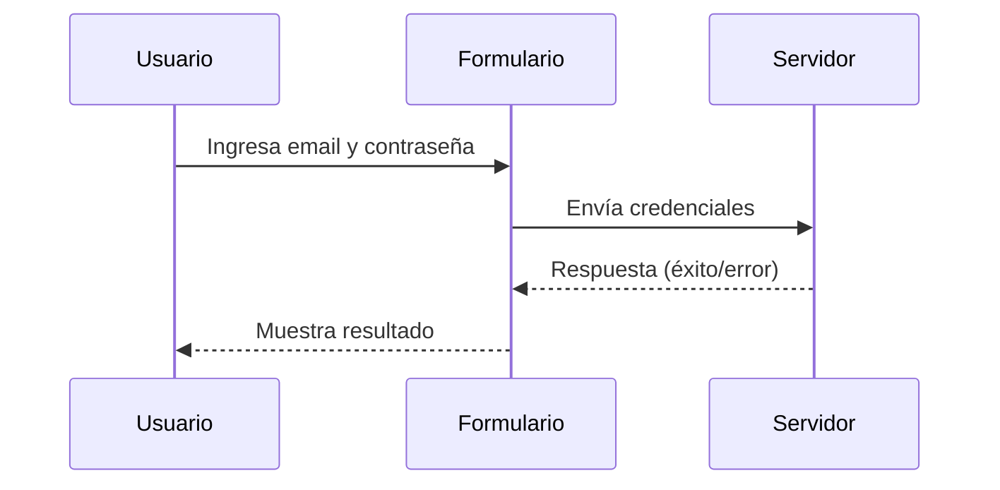
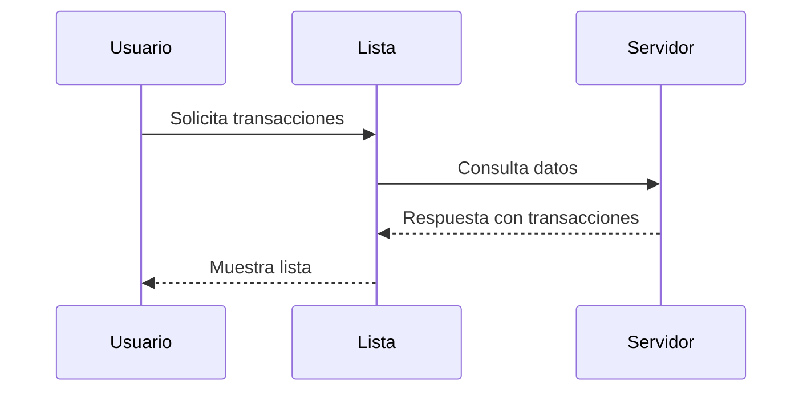

# Guía de la Librería de Componentes

## Introducción
Esta guía documenta la librería de componentes reutilizables diseñada para el equipo de diseño de la empresa fintech. La librería sigue los principios de Atomic Design y está estructurada en capas: Foundations, Components, Patterns y Templates.

## Estructura de la Librería
La librería está organizada en las siguientes capas:

- **Foundations**: Contiene los design tokens (colores, tipografías, espaciados) y guías de accesibilidad.
- **Components**: Componentes atómicos y moleculares como botones, inputs y cards.
- **Patterns**: Combinaciones de componentes para resolver problemas comunes.
- **Templates**: Plantillas de pantallas completas.

## Componentes
### Botón
**Descripción**: Componente reutilizable para acciones primarias y secundarias.

**Estados**:
- Default
- Hover
- Focus
- Disabled
- Error
- Loading

**Ejemplo de Uso**:
```json
{
  "type": "button",
  "label": "Enviar",
  "state": "default",
  "color": "primary"
}
```

**Criterios de Accesibilidad**:
- Contraste mínimo de 4.5:1 (WCAG 2.2).
- Área de clic mínima de 48x48 píxeles.
- Orden de tabulación lógico.

### Input
**Descripción**: Componente para entrada de datos del usuario.

**Estados**:
- Default
- Focus
- Error
- Disabled

**Ejemplo de Uso**:
```json
{
  "type": "input",
  "label": "Nombre",
  "placeholder": "Ingrese su nombre",
  "state": "default"
}
```

**Criterios de Accesibilidad**:
- Etiqueta asociada mediante `for` o `aria-label`.
- Mensajes de error accesibles con `aria-live`.
- Contraste mínimo de 3:1 para texto y bordes.

### Card
**Descripción**: Componente para agrupar información relacionada.

**Estados**:
- Default
- Hover

**Ejemplo de Uso**:
```json
{
  "type": "card",
  "title": "Tarjeta de Crédito",
  "content": "Saldo disponible: $1,200.00",
  "state": "default"
}
```

**Criterios de Accesibilidad**:
- Estructura semántica con encabezados.
- Contraste adecuado para texto y fondos.

## Patrones
### Formulario de Login
**Descripción**: Patrón para formularios de autenticación.

**Componentes Utilizados**:
- Input (email y contraseña)
- Botón (submit)

**Ejemplo de Uso**:


**Criterios de Accesibilidad**:
- Orden de tabulación lógico.
- Mensajes de error accesibles.

### Lista de Transacciones
**Descripción**: Patrón para mostrar transacciones recientes.

**Componentes Utilizados**:
- Card

**Ejemplo de Uso**:


**Criterios de Accesibilidad**:
- Estructura semántica con listas.
- Contraste adecuado para texto.

## Mejores Prácticas
1. **Consistencia**: Usar los design tokens para garantizar consistencia visual.
2. **Accesibilidad**: Verificar cumplimiento de WCAG 2.2 en todos los componentes.
3. **Reutilización**: Diseñar componentes con variantes para cubrir todos los estados posibles.
4. **Documentación**: Mantener actualizada la documentación de cada componente.

## Mantenimiento
- **Revisión Trimestral**: Evaluar la relevancia y efectividad de los componentes.
- **Feedback del Equipo**: Recoger comentarios de diseñadores y desarrolladores.
- **Actualización de Tokens**: Revisar y actualizar los design tokens según necesidades del producto.

## Referencias
- [WCAG 2.2](https://www.w3.org/TR/WCAG22/)
- [Atomic Design](https://bradfrost.com/blog/post/atomic-web-design/)
- [Material Design 3](https://m3.material.io/)